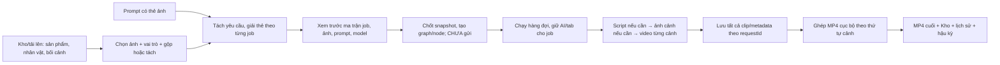
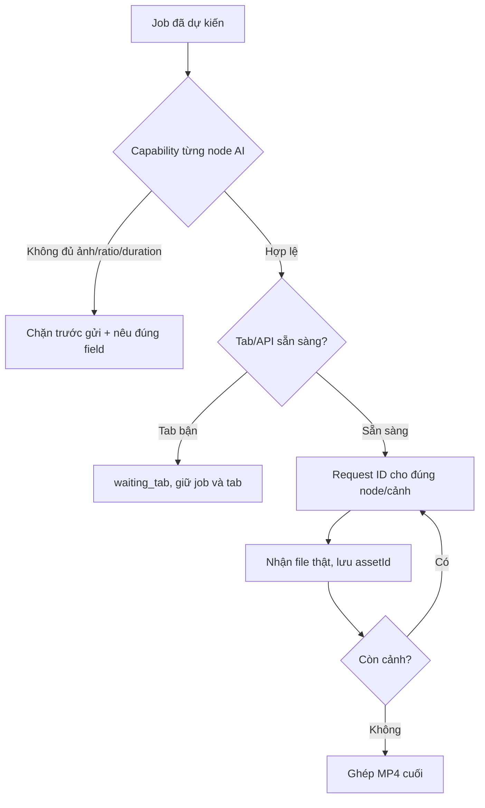
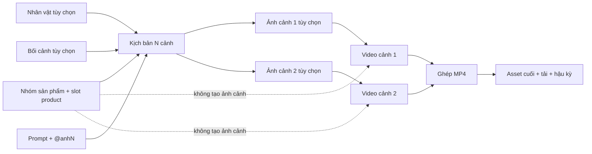

# Đặc tả triển khai: tạo video hàng loạt từ ảnh, prompt đến MP4

**Áp dụng cho:** `mktminhqpbga-glitch/App-MooZ-Workflow`, trang “Tạo video hàng loạt”. Đây là tài liệu bàn giao hành vi và dữ liệu để đối tác sửa app; các mục ghi **cần triển khai** chưa phải tính năng đã chạy. Không quy định vị trí nút, màu hay bố cục. Giao diện tự sắp theo hệ thiết kế chung của app, nhưng phải cho người dùng thấy rõ ảnh nào thuộc job nào, số job dự kiến, trạng thái và kết quả.

## 1. Kết quả cần đạt, hiểu bằng một ví dụ

Người dùng có 3 ảnh: ảnh nhân vật A, ảnh chai nước B và ảnh nền quán cà phê C. Họ nhập:

> `@anh1 đang cầm sản phẩm @anh2 và giới thiệu sản phẩm trong bối cảnh @anh3.`

App phải cho chọn và đặt vai trò **nhân vật** cho A, **sản phẩm** cho B, **bối cảnh** cho C; hiện ba chip ảnh có tên và số tương ứng. Kéo C vào vị trí con trỏ trong prompt sẽ chèn đúng thẻ `@anh3`, đồng thời gắn C vào job nếu chưa chọn. Khi bấm tạo kế hoạch, app lưu ba **asset ID** và vai trò, không chỉ ba chữ `@anh...`. Trước khi gửi, app cho xem prompt đã giải: “Ảnh 1 = nhân vật A; ảnh 2 = chai B; ảnh 3 = quán C”. AI nhận đúng ba file theo đúng thứ tự/role mà adapter hỗ trợ. Tạo video cảnh, lưu clip thật, ghép và có MP4 cuối mở/tải được. Nếu model chỉ nhận một ảnh, app báo không tương thích **trước khi gửi**; không âm thầm lấy ảnh đầu tiên và bỏ hai ảnh sau.

Người dùng có thể chọn **nhiều ảnh sản phẩm**, không bị khóa ở một ảnh. Hai cách xử lý là lựa chọn rõ ràng:

- **Tách đơn ảnh:** mỗi ảnh sản phẩm là một sản phẩm/job độc lập. Chọn 3 ảnh, 1 prompt, 2 bản tạo cho mỗi ảnh ⇒ **6 job**, mỗi job có ảnh sản phẩm riêng, cộng các ảnh nhân vật/bối cảnh chung nếu chọn. Không ghép ba ảnh thành một input.
- **Gộp ảnh vào một sản phẩm:** 3 ảnh là ba góc/chi tiết của **cùng một sản phẩm**, thuộc **một job** cho mỗi prompt/bản tạo. AI nhận cả ba ảnh nếu model cho phép. “Gộp” là gộp **quan hệ tham chiếu**, không tự tạo ảnh collage. Nếu thật sự cần một file collage, đó là bước “Ghép ảnh thành ảnh mới” riêng, có preview và asset ID mới.

**Quy tắc số job:** `số nhóm sản phẩm × số yêu cầu prompt × số bản tạo`. Với chế độ gộp, một nhóm chứa nhiều ảnh. Với chế độ tách, mỗi ảnh tạo một nhóm. Ảnh nhân vật/bối cảnh dùng chung **không** nhân số job. Không tự làm tích Descartes giữa từng ảnh nhân vật và từng ảnh sản phẩm; nếu người dùng muốn nhiều nhân vật tạo nhiều phiên bản, phải chọn rõ chế độ mở rộng đó trong tương lai.



## 2. Đối chiếu mã hiện tại: chỗ nào đang sai/thiếu

| Mã hiện tại | Đang làm | Cần thay đổi |
| --- | --- | --- |
| `modules.js`, `source`/`selectImage()` | Một `source.value`, một `sourceId` ảnh đầu vào; click ảnh mới thay ảnh cũ. | Dùng danh sách/nhóm ảnh sản phẩm có thứ tự; nút bỏ từng ảnh; chọn rõ tách/gộp. |
| `modules.js`, `characterIds` | Cho chọn nhiều ảnh từ Kho dưới nhãn nhân vật, nhưng mọi ảnh trong Kho đều hiện như ứng viên nhân vật. | Có bộ chọn nhân vật dễ hiểu, role riêng, preview và khả năng chọn ảnh nào thuộc cùng nhân vật. Cho phép không chọn. |
| `core/queue-plan.js`, `prepareBatch()` | Một `sourceId`, `characterIds`, ảnh `@tag`; mỗi prompt × copies thành job. | Nhận `productGroups[]` và `referenceSlots[]`; nhân thêm nhóm sản phẩm đúng chế độ, không mất ảnh; kiểm giới hạn trước khi ghi job. |
| `core/queue-plan.js`, `mentions()` | Regex nhận `@tag`, đổi sang `@{asset:id}`. | Hỗ trợ chip `@anh1`, @tag có escape, vị trí con trỏ, kéo ảnh vào prompt; parse theo token/asset ID, không thay chữ mù. |
| `core/flow-plan.js`, `buildFlow()` | Tạo `imageInput` cho mọi reference; graph 1–12 cảnh; tùy chọn ảnh trước video. | Giữ role, slot và thứ tự ở node/edge để prompt và file thực tương ứng. |
| `core/runner.js` | Đổi `@{asset:id}` thành `[Ảnh n]` theo `imageIds`; mô tả role product/character. | Ánh xạ số ảnh phải lấy từ **thứ tự gửi thực tế**, gồm background; bảo toàn cả ảnh trong prompt qua bước kịch bản và từng cảnh. |
| `core/queue-runner.js` | Chỉ cấp `queued`; một tab một job trong phiên quản lý. | Job chờ tab bận phải ở `waiting_tab` và tự chạy sau, theo tài liệu gửi–nhận riêng. |

**Không sửa bằng cách chỉ bật `multiple` cho `<input>`:** nếu storage, plan, graph, runner và bridge vẫn nhận `sourceId`, ảnh thứ hai trở đi sẽ bị bỏ hoặc không đến AI. Phải truyền danh sách asset/role từ draft tới snapshot và tới từng cổng node.

## 3. Từ vựng và hợp đồng dữ liệu

| Khái niệm | Ý nghĩa | Ví dụ |
| --- | --- | --- |
| Asset | File ảnh/video trong Kho, ID ổn định, Blob, MIME, kích thước, hash. | `asset-product-front` |
| Product group | Một **sản phẩm** cần làm video, gồm 1–n ảnh/góc nhìn. | Chai nước: mặt trước, mặt sau, cận nhãn. |
| Reference slot | Một ảnh tham chiếu có role và token hiển thị trong prompt. | `@anh2` → ảnh chai mặt trước, role `product`. |
| Request/prompt | Một yêu cầu độc lập sau khi tách khối/dòng. | “Người mẫu nâng chai…” |
| Batch job | Một group × một request × một bản tạo; có snapshot riêng. | Job 04, prompt 2, chai B. |
| Scene | Phân đoạn trong một job, mỗi cảnh có script và clip. | Cảnh 1 cận chai; cảnh 2 uống nước. |
| AI request | Một lần gửi cụ thể cho một node/cảnh. | `requestId` của video cảnh 2. |
| Final result | MP4 đã ghép; asset ID và metadata. | `resultId` của job 04. |

```json
{
  "batchDraftVersion": 2,
  "kind": "video",
  "productMode": "separate",
  "productGroups": [
    { "groupId": "product-A", "name": "Chai A", "assetIds": ["front-A"] },
    { "groupId": "product-B", "name": "Chai B", "assetIds": ["front-B"] }
  ],
  "sharedReferences": [
    { "assetId": "person-1", "role": "character", "displayName": "Người mẫu", "slot": "anh1" },
    { "assetId": "cafe-1", "role": "background", "displayName": "Quán", "slot": "anh3" }
  ],
  "productSlots": [{ "role": "product", "slot": "anh2", "groupImageIndex": 0 }],
  "prompts": [
    { "id": "prompt-1", "text": "@anh1 đang cầm @anh2 trong bối cảnh @anh3" }
  ],
  "copiesPerCombination": 1,
  "workflow": { "scenes": 2, "createSceneImages": false, "templateId": null },
  "generation": { "provider": "muse", "tabId": 123, "ratio": "9:16", "durationPerScene": 8, "resolution": "720P", "quality": "medium" }
}
```

Đây là **schema mục tiêu** để thống nhất giữa UI, queue và graph, không phải JSON đang có. `assetId` là khóa thật, `slot` chỉ là tên người dùng đọc. Role hợp lệ ở đợt đầu: `product`, `character`, `background`, `style`, `reference`. Không dùng `characterIds` để chứa ảnh khung cuối của chế độ Đầu → Cuối; đó là hai input có vai trò `firstFrame`/`lastFrame` khác. Mỗi item phải có `assetId` riêng; ảnh trùng hash có thể dùng một Blob vật lý nhưng vẫn giữ role/slot rõ ràng.

## 4. Người dùng chuẩn bị ảnh như thế nào

1. **Tải ảnh từ máy hoặc chọn Kho.** PNG/JPG/WebP giải mã được, giới hạn hiện tại 8 MB/ảnh; ảnh lỗi/không có Blob chặn trước khi xếp. Hiển thị thumbnail thật, tên, kích thước, dung lượng, role và token. Ảnh có thể đến từ node Canvas/kết quả cũ; sau khi xếp phải snapshot Blob hoặc tham chiếu bất biến để xóa nguồn không làm job hỏng.
2. **Chọn ảnh sản phẩm không giới hạn ở một `<select>` đơn.** Người dùng chọn nhiều ảnh; từng ảnh có nút bỏ/đổi thứ tự. Chọn chế độ **tách** hoặc **gộp**. Mặc định gộp chỉ khi người dùng chủ động chọn; không đoán các ảnh giống nhau là cùng sản phẩm. Có thể tạo nhiều nhóm thủ công: sản phẩm A có 3 góc, B có 2 góc, mỗi nhóm là một job với cùng prompt.
3. **Chọn ảnh nhân vật tùy chọn.** Một nhân vật có thể có một hoặc nhiều ảnh góc nhìn nếu model và tổng giới hạn cho phép. Nhân vật không được nhập nhằng với sản phẩm: UI lưu role `character`; preview cho thấy ảnh nào thuộc nhân vật nào. Không chọn nhân vật thì bỏ hẳn nguồn đó, không tạo slot rỗng giả. Chọn thêm bối cảnh/phong cách nếu cần, role riêng.
4. **Gắn slot có thứ tự.** Thí dụ nhân vật `@anh1`, sản phẩm `@anh2`, bối cảnh `@anh3`. Nếu có ảnh mặt sau của cùng sản phẩm, thêm `@anh4` hoặc một tên ổn định như `@mat-sau`; role vẫn là product. App hiển thị bảng slot cạnh prompt và prompt preview. Nếu hai slot trỏ cùng một asset có chủ ý thì gửi file một lần và map hai alias về cùng file; không tính hai ảnh vật lý.
5. **Kiểm giới hạn mỗi AI request.** Graph runner hiện tối đa 8 ảnh/lượt, 8 MB/ảnh, 32 MB tổng snapshot. Model/tab có thể có giới hạn chặt hơn; tính với **tất cả** ảnh sản phẩm + nhân vật + bối cảnh + ảnh cảnh trung gian. Nếu vượt, chặn job cụ thể và gợi ý giảm ảnh/chọn model khác; tuyệt đối không âm thầm cắt danh sách. Ảnh cảnh do AI tạo được thêm sau có thể đẩy tổng lên 9, nên preflight phải tính cả cổng đầu vào dự kiến.

### Quy tắc “gộp ảnh” và “tách đơn ảnh” không được mơ hồ

| Chọn 3 ảnh | Plan tạo | File gửi mỗi video request | Kết quả mong đợi |
| --- | --- | --- | --- |
| Tách đơn | 3 group × prompt × copies | Mỗi job nhận **một** ảnh sản phẩm tương ứng; ảnh nhân vật chung nếu chọn. | Ba MP4 riêng cho ba sản phẩm/góc đã định. |
| Gộp thành một sản phẩm | 1 group × prompt × copies | Mỗi job nhận **cả ba** ảnh sản phẩm theo slot/role nếu provider hỗ trợ. | Một MP4 dùng cùng sản phẩm từ ba góc tham chiếu. |
| Nhóm thủ công A(2 ảnh), B(1 ảnh) | 2 group × prompt × copies | Job A nhận 2 ảnh; job B nhận 1 ảnh. | Hai MP4, một cho A và một cho B. |

Không tự ghép ảnh pixel thành collage chỉ để vượt giới hạn upload. Collage có thể làm AI khó hiểu ai là nhân vật, đâu là sản phẩm; nếu người dùng chọn công cụ collage, lưu asset mới và ghi provenance nguồn. Nếu user muốn **một video lần lượt quảng cáo ba sản phẩm**, đó là một group/câu chuyện nhiều cảnh với role và script rõ từng cảnh, **không** dùng chế độ tách ba job.

## 5. Prompt và thẻ ảnh: cú pháp, kéo thả, thứ tự gửi

### 5.1 Cú pháp hiển thị cho người dùng

`@anh1`, `@anh2` là alias dễ đọc; `@ten-tag` từ Kho vẫn có thể hỗ trợ để tương thích dữ liệu cũ. App không gửi nguyên chuỗi `@anh1` như chỉ dẫn mơ hồ. Khi chốt job, app biến nó thành token nội bộ gắn **asset ID + role + slot**, và ở lúc chạy biên dịch lại theo thứ tự ảnh thực tế của provider: ví dụ `@anh1` → `[Ảnh 1]`, `@anh2` → `[Ảnh 2]`. Đừng giả định `@anh2` luôn là ảnh upload thứ hai nếu adapter đổi thứ tự; adapter phải trả mapping applied.

```text
Người dùng thấy: @anh1 đang cầm sản phẩm @anh2 trong bối cảnh @anh3.
Snapshot job B: @anh1=person-1 (character), @anh2=front-B (product), @anh3=cafe-1 (background).
Ảnh upload thực: 1=person-1, 2=front-B, 3=cafe-1.
Prompt gửi: [Ảnh 1] đang cầm sản phẩm [Ảnh 2] trong bối cảnh [Ảnh 3].
Hướng dẫn role: Ảnh 1 là nhân vật, giữ khuôn mặt; Ảnh 2 là sản phẩm, giữ bao bì/logo; Ảnh 3 là bối cảnh.
```

Trong **chế độ tách**, `@anh2` là **slot sản phẩm của job hiện tại**, nên job A bind front-A, job B bind front-B. Đây là alias theo **job**, không phải tag cố định toàn Kho. Nếu muốn cố định đúng một ảnh trên mọi job, dùng `@tag`/chip asset cố định và app phải hiển thị rằng nó là ảnh chung. Nếu prompt nói `@anh4` nhưng job chỉ có ba slot, chặn cả đợt trước khi tạo node; không xóa token, không gửi văn bản thiếu ảnh.

### 5.2 Kéo ảnh vào chỗ đang nhập để gọi nhanh

Người dùng có thể kéo thumbnail từ Kho/nhóm ảnh vào **đúng vị trí con trỏ hoặc vị trí thả** trong prompt. App chèn chip nguyên tử chứa `{assetId, role, slot, label}` và hiển thị `@anhN`. Khi thả ảnh chưa được chọn, app thêm ảnh vào nguồn của job/draft theo role đã chọn hoặc hỏi role một lần; không chỉ chèn chữ rồi quên file. Khi thả ảnh đã chọn, chỉ chèn token, không nhân đôi file. Phím Backspace xóa chip/token tại con trỏ, **không tự xóa asset khỏi nhóm**; bỏ ảnh khỏi nhóm thì các chip dùng ảnh đó báo lỗi “tham chiếu đã thiếu” để người dùng chọn ảnh khác hoặc xóa token. Undo/redo giữ cả văn bản và chip. Paste `@anh2` dạng text phải được phân tích và kiểm tra tương tự drag.

```js
// Mẫu thiết kế: dataTransfer chỉ mang ID nội bộ, không truyền Blob qua text/drop.
thumbnail.draggable = true;
thumbnail.addEventListener('dragstart', event => {
  event.dataTransfer.setData('application/x-mooz-asset-id', asset.id);
  event.dataTransfer.effectAllowed = 'copy';
});

promptEditor.addEventListener('dragover', event => {
  if (event.dataTransfer.types.includes('application/x-mooz-asset-id')) event.preventDefault();
});
promptEditor.addEventListener('drop', async event => {
  const id = event.dataTransfer.getData('application/x-mooz-asset-id');
  if (!id) return;
  event.preventDefault();
  const asset = await readImageAsset(id); // kiểm thuộc Kho/draft, MIME, Blob
  const slot = ensureReferenceSlot(draft, asset, currentRole());
  const point = editorPositionFromDrop(promptEditor, event.clientX, event.clientY);
  insertAtomicReference(promptEditor, point, { assetId: id, slot: slot.name });
  saveDraft(draft); // lưu cùng document model, không chỉ innerHTML
});
```

Với `<textarea>` thuần, có thể dùng `selectionStart/selectionEnd` khi click chip “Chèn vào con trỏ”; khi drag thật, `selectionStart` có thể là vị trí cũ, nên cần tính caret từ tọa độ thả (hoặc dùng editor có token model). `DataTransfer` không được tin ID từ website ngoài; kiểm ID tồn tại trong Kho và quyền hiện tại. Hỗ trợ bàn phím tương đương: focus thumbnail rồi “Chèn vào prompt”. Trên mobile không có drag, cho chọn ảnh rồi chèn tại caret. Token nên là object trong document model; `@anhN` chỉ là bản render, nhờ đó đổi tên/đổi thứ tự slot không làm prompt âm thầm trỏ ảnh khác.

### 5.3 Parse prompt và kiểm tra token

**Không dùng regex duy nhất làm nguồn sự thật.** Parser phải bỏ qua email `a@b.com`, `@@` escape và thẻ trong đoạn code nếu app cho phép; chỉ nhận alias có ranh giới token. Tag Kho có thể chứa chữ/số/dấu `_`/`-`; tên tiếng Việt hiển thị khác alias ASCII. Sau parse, liệt kê `usedSlots[]`, báo `missingSlots[]`, `unusedSelectedSlots[]` (unused chỉ cảnh báo vì ảnh chọn có thể dùng chung không được nhắc trong câu). File gửi lấy **tập slot/asset đã chọn cho job** theo thứ tự ổn định; token chỉ giúp AI hiểu vai trò, không quyết định file có được gửi hay không. Có thể cho “Chỉ gửi ảnh được gọi trong prompt” như một lựa chọn riêng sau này, nhưng mặc định mọi ảnh đã chọn và còn hợp lệ đều được gửi.

```js
// Mẫu compiler sau khi đã có token model; không dùng replace toàn văn theo tên file.
function compilePrompt(tokens, slots, uploadedOrder) {
  return tokens.map(token => {
    if (token.type === 'text') return token.value;
    if (token.type !== 'image-ref') throw Error('Token không hợp lệ');
    const slot = slots.find(x => x.slotId === token.slotId);
    if (!slot) throw Error(`Thiếu ảnh cho ${token.label}`);
    const index = uploadedOrder.findIndex(id => id === slot.assetId);
    if (index < 0) throw Error(`Ảnh ${slot.assetId} chưa được upload`);
    return `[Ảnh ${index + 1}]`;
  }).join('');
}
```

## 6. Tách nhiều yêu cầu: một prompt nào thuộc job nào?

App hiện có bốn cách: khối `[ ... ]`, mỗi dòng, mỗi đoạn cách dòng trống, gộp toàn văn. Mặc định `[ ... ]` cho phép một yêu cầu nhiều dòng. **Một yêu cầu = một video thành phẩm** sau khi nhân với nhóm sản phẩm và copies; nếu muốn một video nhiều cảnh, chọn số cảnh trong **cùng yêu cầu**, không tách mỗi cảnh thành một batch job. Trước khi xếp, UI phải hiện bảng review, không chỉ báo “N yêu cầu”.

| Input | Chế độ | Sản phẩm | Copies | Job |
| --- | --- | --- | --- | --- |
| `[Quay cận @anh2] [Nhân vật @anh1 giới thiệu @anh2]` | Khối | 3 ảnh tách | 1 | 2 × 3 = 6. |
| `Quay cận @anh2\nNhân vật giới thiệu @anh2` | Mỗi dòng | 2 nhóm thủ công | 2 | 2 × 2 × 2 = 8. |
| Một mô tả dài có xuống dòng | Toàn văn | 3 ảnh gộp 1 nhóm | 1 | 1. |

Tối đa hiện tại 50 prompt/đợt, 20.000 ký tự/prompt, 200 job trong hàng đợi. Nếu kết hợp nhóm/copies vượt 200, báo số lượng dự kiến **trước khi tạo bất kỳ project/job nào**. “Bản tạo” là các lượt AI độc lập với request ID khác; không phải sao chép cùng MP4. Nếu ảnh nhân vật chung xuất hiện trong 8 job, snapshot vật lý nên dedupe Blob theo hash/asset ID nhưng mỗi job giữ mapping role riêng.

## 7. Kiểm tra AI/model trước khi tạo kế hoạch

Chọn provider và đúng tab/API có khả năng **video**. Một job giữ **cùng provider và tab được gán** qua các bước AI của luồng; việc đang chờ tab bận phải được xếp hàng theo tài liệu [gửi–nhận AI](RELIABLE-AI-TAB-QUEUE-RESULT-HANDOFF.md). Trước khi chốt, bảng capability cần trả lời:

1. Model có nhận bao nhiêu ảnh cho **từng** bước: đọc ảnh/kịch bản, tạo ảnh cảnh, tạo video cảnh? Một model video chỉ nhận 1 ảnh không thể xử lý ba tham chiếu trực tiếp. Nếu luồng có bước tạo ảnh trung gian hợp pháp để gom ngữ nghĩa, nói rõ ảnh nào được dùng ở bước nào và video sẽ chỉ nhận ảnh cảnh; không hứa video nhận ba ảnh gốc.
2. Model có hỗ trợ role/ordered references, khung đầu–cuối, ảnh nhân vật, bối cảnh không? Nếu không, **disable hoặc chặn** luồng tương ứng. “Đầu → Cuối” là chế độ khác, bắt buộc đúng hai ảnh và model hỗ trợ; không dùng nhân vật tùy chọn ở đây theo code hiện tại.
3. Model hỗ trợ tỷ lệ, độ phân giải, chất lượng, thời lượng nào? Ghi `{requested, applied, observed}`. Không chọn 1080P rồi tự hạ xuống 720P không báo. Với tab AI, nhiều cài đặt chỉ có thể đưa vào prompt; UI phải hiển thị đó là yêu cầu, chưa được xác nhận.
4. Model có trả file video thật hay chỉ poster/preview? Có thể tải file trong quyền tab/API không? Nếu không, không nên cho chạy lô lớn.
5. Tab cần login/captcha/credit? Kiểm `ready` và điều kiện bận trước khi cấp việc; không đánh dấu job lỗi chỉ vì tab đang tạo video khác.



## 8. Tạo graph cho **một** job video: node nào đi qua node nào

Người dùng làm trên **một luồng làm việc**; mỗi job là một bản graph riêng từ cùng template, không phải hai form làm việc khác nhau. Ảnh sản phẩm/nhân vật/bối cảnh là input có role, prompt là input, clip cảnh và MP4 là output. Edge/port quyết định dữ liệu; đặt node gần nhau trên Canvas không tạo kết nối.

### Luồng một cảnh

`Ảnh tham chiếu + prompt → [tạo ảnh cảnh nếu người dùng chọn và model cần] → tạo video → kiểm clip thật → lưu asset → MP4 thành phẩm/Kho`.

Nếu đã có một ảnh tốt và video model nhận nó, bỏ bước tạo ảnh để tiết kiệm lượt AI. Nếu model tạo video từ text không nhận ảnh nhưng job bắt buộc giữ nhận diện sản phẩm, phải báo không tương thích hoặc đổi model/luồng theo lựa chọn người dùng. Không âm thầm bỏ sản phẩm.

### Luồng nhiều cảnh

`Ảnh/role + prompt tổng → viết kịch bản JSON đúng N cảnh → [ảnh riêng từng cảnh nếu chọn] → video riêng từng cảnh → lưu N clip → ghép theo index → MP4 cuối`.

Script phải có `index`, `title`, `voiceover`, `imagePrompt`, `videoPrompt`, có thể có `duration`. Validate đúng N cảnh (1–12 hiện tại), đúng thứ tự, không thiếu prompt. Lưu raw AI text để sửa nếu JSON hỏng; **dừng trước bước tạo video**, không tạo cảnh đoán mò. Mỗi cảnh dùng riêng `videoPrompt`; nếu cần nhắc lại slot, script compiler phải giữ mapping ảnh gốc và role. `voiceover` trong script **không bảo đảm video có tiếng nói**; cần TTS/hậu kỳ riêng để lồng tiếng chính xác.



**Quan trọng khi tạo ảnh trung gian:** nếu ảnh cảnh được tạo từ nhiều refs, video node nhận ảnh cảnh theo edge; refs gốc khác chỉ truyền thêm nếu model video và graph cho phép. Không vô tình gửi ảnh sản phẩm cũ cộng ảnh cảnh và vượt 8 ảnh. Khi graph dùng `generateText` để viết kịch bản, các `@anhN` trong prompt đầu phải được giải theo cùng slot; các prompt cảnh do AI sinh không được tự gán `@anhN` mới không tồn tại.

## 9. Tạo kế hoạch, chạy queue, nhận kết quả: từng trạng thái

1. **Draft:** chọn ảnh, vai trò, gộp/tách, prompt, số cảnh, có tạo ảnh cảnh hay không, AI/tab, ratio/duration/quality. Mọi thay đổi chỉ ở draft.
2. **Preflight:** parse mọi prompt, tính ma trận job, bind slot từng job, kiểm file/mime/hash/giới hạn, capability từng node, cấu trúc graph và thứ tự ảnh upload. Nếu một job lỗi, bảng preview đánh dấu dòng cụ thể và chưa xếp **bất kỳ** job nào (toàn đợt atomic).
3. **Chốt snapshot:** “Thêm & tạo node” lưu graph, ảnh/role/slot, prompt gốc, prompt compiled preview, provider/tab preference, setting, phiên bản plan. Tạo `jobId`; **chưa gửi AI**. Đổi draft sau đó không đổi job đã chốt. Tên job nên có `productName · promptIndex · copyIndex`.
4. **Chạy hàng đợi:** scheduler cấp job; tab chọn cố định A thì chờ A. Tab tự chọn được gán một tab phù hợp đúng một lần khi bắt đầu, sau đó không tự đổi giữa các cảnh. Đặt trạng thái `waiting_tab`, `preparing`, `sent`, `collecting`, `partial`, `done`, `needs_review` có lý do. Một tab không nhận hai lượt đồng thời. Với server/extension mất kết nối sau gửi, hỏi đúng request cũ, không bấm gửi lại.
5. **Mỗi AI node/cảnh:** tạo `requestId` riêng, upload đúng file theo slot/role, xác nhận ảnh đã tải xong, áp settings hỗ trợ, gửi prompt, lưu dấu tin user đã gửi, chờ đúng assistant turn mới. Tải video file thật; không chấp nhận poster. Lưu clip `assetId`, metadata thực (width/height/duration/MIME/hash) và checkpoint vào job trước khi sang cảnh sau.
6. **Ghép MP4:** chỉ khi đủ clip thật theo thứ tự cảnh. Dùng công cụ local của app/FFmpeg WASM, giữ clip nguồn và xuất asset MP4 mới. Nếu cảnh 3 lỗi, giữ clip 1–2, chưa có thành phẩm giả; người dùng có thể kiểm tra rồi tiếp tục từ cảnh 3, không tạo lại cảnh 1–2.
7. **Kết quả:** mỗi job có MP4 cuối riêng, thumbnail/preview, thời lượng thực, kích thước thực, tên product group, prompt snapshot và danh sách clip cảnh. Tải một/tất cả kết quả, lưu Kho, mở hậu kỳ. Nếu AI trả nhiều biến thể, lưu `results[]`; selected asset cấp cho edge downstream, không làm mất các biến thể khác.

```mermaid
sequenceDiagram
  actor U as Người dùng
  participant Draft as Form/Prompt editor
  participant Plan as Batch planner
  participant Q as Queue
  participant AI as AI adapter/tab
  participant Store as Kho media
  participant FF as Ghép video local
  U->>Draft: Chọn 3 ảnh, mode tách/gộp, nhân vật, @anhN
  Draft->>Plan: Preflight toàn đợt, xem trước ma trận job
  U->>Plan: Thêm & tạo node
  Plan->>Q: Snapshot N job; chưa gửi AI
  U->>Q: Chạy hàng đợi
  loop Mỗi job, mỗi cảnh đúng graph
    Q->>AI: requestId + prompt compiled + ordered references
    AI-->>Q: Đúng video file / trạng thái cần đối chiếu
    Q->>Store: Validate + lưu clip, assetId
  end
  Q->>FF: Clip cảnh đã lưu theo index
  FF->>Store: MP4 cuối của job
  Store-->>U: Preview, tải, hậu kỳ
```

**Bất biến dữ liệu:** `jobId` phân biệt thành phẩm; `requestId` phân biệt một lượt AI; `assetId` phân biệt file. `productGroupId`, `promptId`, `copyIndex`, `sceneIndex` luôn lưu cùng job. Không dò kết quả bằng “ảnh/video mới nhất trong tab” vì sẽ nhầm giữa các job. Chi tiết gửi–nhận/ACK/khôi phục xem [tài liệu tab, queue và kết quả](RELIABLE-AI-TAB-QUEUE-RESULT-HANDOFF.md).

## 10. Mã mẫu planner để đối tác sửa đúng điểm một ảnh

Đây là **pseudocode có thể chuyển thành JavaScript**, chưa phải API đã có. Thay `sourceId` bằng `productGroups[]`; mỗi group bind slot sản phẩm riêng, giữ refs chung, rồi nhân prompt/copy. Các hàm `normalizeTokens`, `snapshotAssets`, `validateCapabilities` là phần cần triển khai/test.

```js
function planVideoBatch(draft, assetsById, caps) {
  const prompts = splitPrompts(draft.promptText, draft.splitMode);
  const groups = draft.productGroups.length
    ? draft.productGroups
    : [{ groupId: 'text-only', name: 'Không có ảnh sản phẩm', assetIds: [] }];
  const jobs = [];
  for (const group of groups) for (const [promptIndex, prompt] of prompts.entries()) {
    for (let copy = 1; copy <= draft.copiesPerCombination; copy++) {
      const slots = bindSlotsForJob(draft, group, assetsById);
      const tokens = normalizeTokens(prompt, slots); // @anhN -> slotId/assetId thật
      const unknown = tokens.filter(t => t.type === 'image-ref' && !slots.some(s => s.slotId === t.slotId));
      if (unknown.length) throw Error(`Nhóm ${group.name}: thiếu ảnh ${unknown[0].label}`);
      const distinctAssets = [...new Set(slots.map(s => s.assetId))];
      if (distinctAssets.length > 8) throw Error(`Nhóm ${group.name}: quá 8 ảnh tham chiếu/lượt`);
      for (const id of distinctAssets) validateImage(assetsById.get(id));
      validateCapabilities(draft.workflow, caps, slots); // từng AI node, không chỉ tổng quát
      jobs.push({
        id: crypto.randomUUID(), groupId: group.groupId, groupName: group.name,
        promptIndex: promptIndex + 1, copyIndex: copy, originalPrompt: prompt,
        tokens, slots, inputAssets: snapshotAssets(distinctAssets, assetsById),
        graph: buildVideoGraph({ ...draft.workflow, tokens, slots }),
        provider: draft.generation.provider, selectedTabId: draft.generation.tabId,
        settings: structuredClone(draft.generation), status: 'queued',
      });
    }
  }
  if (jobs.length > 200) throw Error(`Đợt này có ${jobs.length} job, vượt giới hạn 200`);
  return jobs; // caller ghi toàn bộ cùng transaction, không xếp nửa đợt
}
```

Mẫu này giả định `productGroups` đã được dựng đúng: tách đơn ⇒ một group/ảnh; gộp ⇒ một group/nhiều ảnh; nhóm thủ công ⇒ tùy người dùng. **Không** để `productGroups=[]` khi người dùng đã chọn ảnh nhưng form làm rơi selection. `slots` trong mỗi job phải chứa ít nhất tất cả ảnh của group và mọi shared refs đã chọn; không chỉ ảnh xuất hiện trong text. `buildVideoGraph` phải đặt `imageInput`/edge cho mỗi asset và giữ `referenceRoles`/slot order. Chạy `validateGraph` trước transaction. Nếu job với nhiều cảnh có nhiều AI node, kiểm capability và số ảnh **ở từng node**.

## 11. Các tình huống bắt buộc phải hiển thị rõ cho người dùng

| Tình huống | Hành vi đúng |
| --- | --- |
| Chọn ba ảnh sản phẩm rồi chọn Tách | Preview ba group/job cho mỗi prompt; không còn bộ chọn chỉ lưu ảnh cuối. |
| Chọn ba ảnh là cùng sản phẩm rồi chọn Gộp | Preview một group với ba thumbnail; video request nhận cả ba nếu model hỗ trợ. |
| Không chọn nhân vật | Job vẫn tạo được nếu model và prompt không bắt nhân vật; không gửi “ảnh nhân vật rỗng”. |
| Chọn nhân vật + sản phẩm + bối cảnh | Ba role phân biệt; thẻ `@anh1/@anh2/@anh3` gắn đúng file theo từng job. |
| Kéo ảnh vào giữa câu đang nhập | Chip xuất hiện tại vị trí thả/caret, file được chọn, undo/paste hoạt động. |
| Gỡ ảnh đã được gọi bởi prompt | Hiện lỗi token thiếu, chặn xếp tới khi sửa. |
| `@anh2` trong chế độ tách | Mỗi job gắn sản phẩm riêng của group hiện tại, không cùng một asset cho mọi job. |
| Gộp 5 ảnh sản phẩm + 2 ảnh nhân vật + 2 ảnh nền | Preflight báo vượt 8 ảnh/lượt ở node áp dụng; không gửi 8 rồi bỏ ảnh thứ 9. |
| Chọn model video chỉ nhận 1 ảnh, job có 3 refs | Báo không tương thích và yêu cầu chọn model/luồng khác; không bỏ ảnh nhân vật/bối cảnh. |
| Một cảnh video trả poster rồi chưa có MP4 | Job còn `collecting`, không chuyển sang ghép. |
| Job 2 chờ tab đang chạy Job 1 | `waiting_tab`; tự chạy đúng tab sau khi rảnh, không báo lỗi và không chuyển tab. |
| Người dùng sửa draft sau khi xếp | Job cũ giữ prompt, ảnh, slot, model và settings đã snapshot. |
| Cảnh 3 lỗi sau khi cảnh 1–2 hoàn tất | Giữ clip 1–2; trạng thái cụ thể; retry/reconcile cảnh 3 theo request ID, không chạy lại toàn bộ mù. |

## 12. Thứ tự công việc và điều kiện nghiệm thu cho đối tác

1. **Chốt contract:** định nghĩa `ProductGroup`, `ReferenceSlot`, `BatchJob` và migration job cũ có `sourceId` thành một group một ảnh. Giữ khả năng mở dự án cũ.
2. **Sửa draft/UI:** nhiều ảnh sản phẩm, mode tách/gộp/nhóm thủ công, role nhân vật/bối cảnh, thumbnail và slot; drag/drop token + bàn phím; bảng xem trước ma trận job. Không cần áp một bố cục cố định.
3. **Sửa planner:** `core/queue-plan.js` nhận groups/slots; tính job count; parse token; reject toàn đợt nếu một mapping sai, vượt ảnh/bytes/job hoặc AI không hỗ trợ. Test trước khi ghi IndexedDB.
4. **Sửa graph/runner:** `core/flow-plan.js` tạo input/edge theo từng slot; `core/runner.js` upload và đánh số theo thứ tự thực; giữ role product/character/background xuyên script→ảnh→video. Mọi cảnh có `requestId` và checkpoint riêng.
5. **Sửa queue/result:** đồng bộ với tài liệu gửi–nhận AI; giữ job chờ tab bận; lưu clip thật từng cảnh, ghép MP4, lưu toàn bộ biến thể và metadata; restart/đứt relay không gửi trùng.
6. **Kiểm thử thực:** trước hết chạy fixture với ba ảnh ví dụ và so mapping từng file; sau đó 1 job Muse thật, 2 job cùng tab, 1 job nhiều cảnh, 1 model giới hạn một ảnh. Tải mở MP4 sau reload. Chỉ coi xong khi tất cả dòng ở bảng mục 11 đạt.

**Bằng chứng nghiệm thu cần lưu:** `batchId`, `jobId`, `groupId`, `promptId`, bảng slot→assetId, prompt compiled, provider/tab, `requestId` từng cảnh, assetId của từng clip, `resultId` MP4, metadata video thực và log trạng thái. Không cần ghi prompt/ảnh base64 hoặc khóa AI vào log chẩn đoán. Nếu thiếu mắt xích nào, đối tác phải chỉ rõ bước chưa hoàn thiện thay vì hiển thị “Hoàn tất”.
