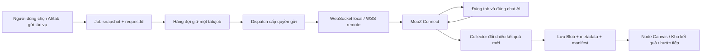
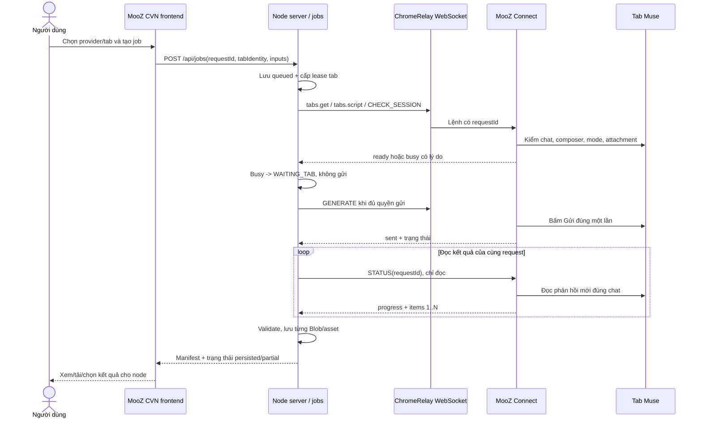
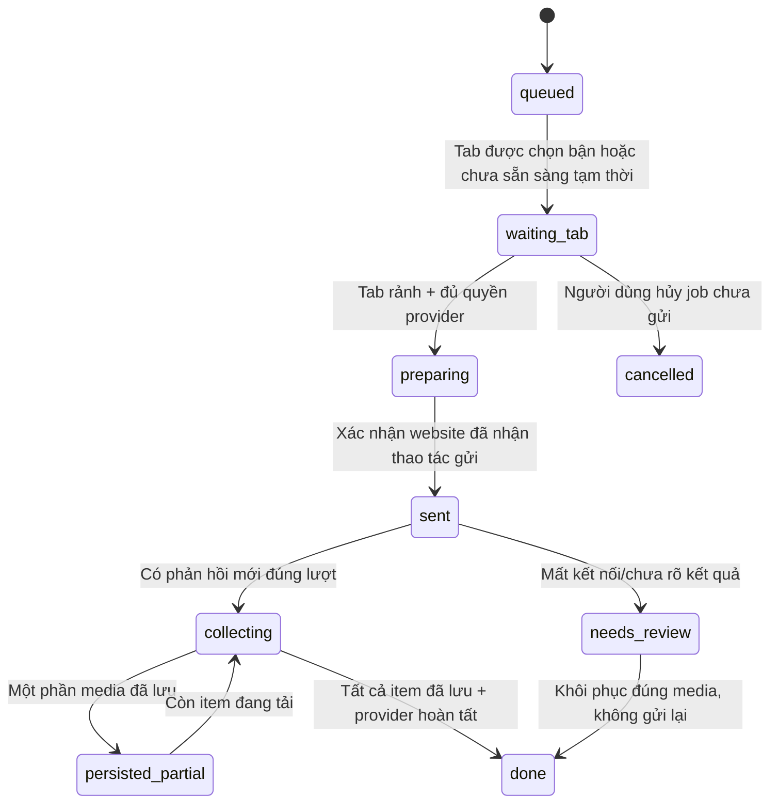
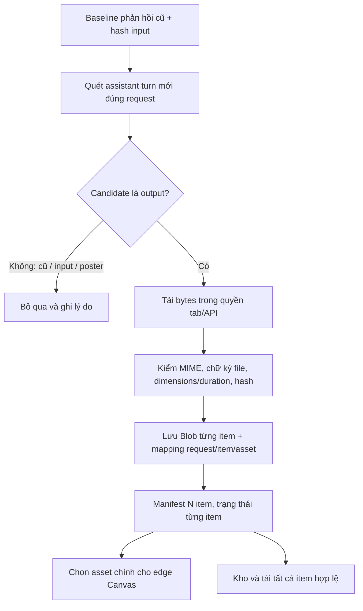
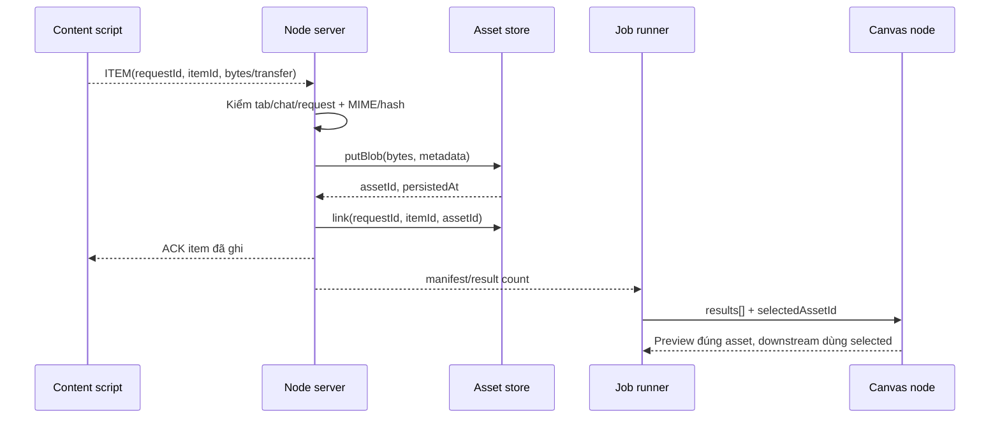

# Bàn giao sửa kết nối tab AI, hàng đợi và nhận kết quả

**Đích áp dụng:** repo `mktminhqpbga-glitch/App-MooZ-Workflow` (MooZ CVN), ảnh màn Canvas người dùng gửi ngày 06/11/2026. Đây là hướng dẫn **triển khai và nghiệm thu** cho đối tác, không phải khẳng định mã hiện tại đã làm xong. App `mktminhqpbga-glitch/app-mooz` là nguồn của một số bridge/relay vendored, nhưng file cần sửa ở repo này được gọi tên cụ thể bên dưới. Tài liệu không áp đặt bố cục hoặc vị trí nút.

## 1. Định nghĩa kết quả cần đạt

Ba lỗi người dùng báo phải được sửa cùng nhau:

1. Tab vẫn mở đúng Muse, người dùng không chạm Chrome, nhưng app báo **“Cuộc trò chuyện/tab đã thay đổi”** hoặc rớt kết nối. App phải phân biệt **socket mất**, **tab ID đổi**, **URL do website tự cập nhật**, **chat thật sự đổi**, **nội dung/bridge chưa sẵn sàng**. Không coi mọi khác biệt chuỗi URL là người dùng đổi chat.
2. Tab đang chạy job A; job B chọn đúng tab ấy. B phải giữ trạng thái **chờ tab**, hiển thị lý do và tự được cấp lượt sau khi A hoàn tất/được đối chiếu. Không gửi B vào tab đang bận, không đánh dấu B lỗi chỉ vì bận, không tự chuyển B sang tab khác.
3. AI đã trả ảnh/video trong đúng cuộc trò chuyện nhưng node vẫn trống. App phải chứng minh lượt gửi, tìm đúng phản hồi mới, tải **tệp media thật**, xác minh và lưu asset, rồi mới gán node/queue. Nếu AI trả nhiều ảnh/clip, lưu toàn bộ item hợp lệ của lượt đó; nếu một item chưa tải được, giữ trạng thái một phần/cần kiểm tra và không mất các item đã lưu.

**Hai điều kiện không thể bỏ qua:** website triển khai dạng static trên Vercel chỉ có frontend; theo `README.md`, bản static **không có `/api/jobs`/relay AI chạy thật**. Muốn kết nối tab AI phải chạy backend Node/Electron tương ứng, có địa chỉ API và kết nối relay tới Chrome; không thể sửa lỗi nhận kết quả chỉ bằng CSS. Khi đổi website AI/model/chế độ, cần kiểm thử bằng phiên thật vì DOM của nhà cung cấp nằm ngoài quyền kiểm soát app.



## 2. Chẩn đoán từ mã hiện có: vì sao ba lỗi xuất hiện

### 2.1 Lỗi “tab/chat đã thay đổi” dù không động Chrome

`server/connection.mjs` hiện chặn URL bằng phép so chuỗi tuyệt đối ở bước `check()`. Sau khi gửi, `generate()` gọi `acceptedChatURL()`; hàm này chỉ chấp nhận URL giữ nguyên hoặc chuyển tiếp New chat → `/c/...` **riêng ChatGPT**. Muse trong ảnh không được hưởng ngoại lệ đó:

```js
if (input.chatURL && tab.url !== input.chatURL)
  throw Error("Cuộc trò chuyện đã thay đổi; chưa gửi yêu cầu.");

// Sau chrome.generate() — Muse đổi URL vẫn bị chặn
if (!acceptedChatURL(input.chatURL, latest.url, result.chatURL, input.provider))
  throw Error("Tab đã đổi cuộc trò chuyện. Kiểm tra kết quả thủ công; không tự gửi lại.");
```

`core/queue-runner.js` chụp `chatURL = tab.url` khi gán tab; `core/runner.js` gửi `chatURL` đó cho server ở mỗi bước. So sánh bằng `===` có thể sai khi website **tự** tạo ID chat sau lượt đầu, thêm/bỏ dấu `/`, redirect locale, chuyển route sau login, thay query không liên quan, hoặc thay URL của cùng project khi UI lưu trạng thái. Đây là **nguyên nhân có cơ sở trong code**, chưa phải kết luận duy nhất cho mọi lần rớt; cần log an toàn để phân biệt. Ngược lại, bỏ hoàn toàn kiểm tra URL sẽ dễ lấy ảnh từ chat khác, nên không sửa bằng `if (url changed) ignore`.

`server.mjs` gọi `await sent()` **trước** `chrome.generate(input)`. Vì vậy nếu bridge đã gửi prompt và website tự đổi URL rồi `connection.generate()` kiểm URL cũ, server ghi job `unknown`; kết quả hợp lệ có thể đã về nhưng bị bỏ. Ngay cả khi extension trả media, phép kiểm URL cuối cũng chặn đường lưu. Nếu `chrome.check()` lỗi trước khi `sent()`, server ghi `error`; UI thường phải thao tác lại, khiến người dùng tưởng kết nối rớt.

**Quy tắc sửa:** phân biệt `tabIdentity` và `conversationIdentity`. `tabIdentity = extension/device instance + Chrome tabId`; `conversationIdentity` là ID chat/project do adapter đọc được, kèm URL chuẩn hóa làm bằng chứng phụ. Tại màn chat mới chưa có ID, ghi `provisional`; chỉ chấp nhận một chuyển tiếp `provisional → actualChatId` khi bridge chứng minh **tin người dùng mang requestId/nonce của lượt vừa gửi** đã xuất hiện trong chat mới. Sau khi bind actualChatId, URL có thể đổi phần không định danh nhưng chat ID không được đổi. Nếu không lấy được ID chắc chắn, giữ kết quả `needs_review` và chỉ cho nhập thủ công đúng lượt; không đánh dấu thành công tùy tiện.

### 2.2 Tab bận bị báo lỗi, queue không thật sự đợi

`server/connection.mjs` ném `TAB_BUSY` khi `MUSEFLOW_CHECK_SESSION`/`WORKFLOW_AI_CHECK` trả `check.busy`. `server/jobs.mjs` bắt lỗi trước `sent` và ghi `status: "error"`. `core/queue-runner.js` chỉ quét job có `status === "queued"`, nên job đã thành `error` sẽ **không được cấp lại** khi tab rảnh. Đây là nguyên nhân trực tiếp cho tình huống người dùng báo.

`ServerJobs.resources` và `ServerJobs.active` là Map **trong RAM của tiến trình Node**. Chúng xếp các request cùng tab khi tiến trình còn sống, nhưng chưa tạo một lease bền vững qua restart. Record `queued` có thể còn trên đĩa; `run()` trả record prior mà không tự thực thi tiếp. Vì vậy phải có quy trình khôi phục/reconcile, không dựa duy nhất vào Map RAM. `core/queue-runner.js` có Web Locks cho một trang quản lý, nhưng tình trạng busy thực của tab vẫn phải được đọc lại từ bridge và không được biến thành lỗi vĩnh viễn.

### 2.3 Ghi nhận kết quả chỉ nhận một media và có thêm điểm chặn

`server/connection.mjs` chỉ chấp nhận một `result.url` bắt đầu bằng `data:image/` hoặc `data:video/`, rồi trả một `{kind,url}`. `core/runner.js::storeResult` cũng nhận một result, ghi một asset và `job.outputs[nodeId] = {kind,assetId}`. `core/output-state.js` merge một `assetId` vào node. Vì vậy nếu website trả nhiều ảnh, chỉ một ảnh có đường đi tới Canvas. Nếu extension trả URL CDN/`blob:`/poster hoặc không copy được media thành data URL, server báo lỗi ngay dù trên tab đã thấy hình.

`server/providers.mjs` cũng lấy phần tử đầu của `data[]` và một `inlineData` đầu tiên. API và tab đều cần contract danh sách `items[]`; chỉ thêm gallery frontend sẽ không khôi phục được item đã bị adapter bỏ qua. Record của `server/jobs.mjs` hiện ghi cả result dạng data URL vào JSON trên đĩa; media lớn làm JSON phình, tăng rủi ro lỗi ghi và khôi phục. Cần tách Blob khỏi metadata request, dùng asset store có kiểm tra hoàn tất.

**Giới hạn cần nói thật:** một website có thể chỉ cho xem preview, video qua MSE, hoặc URL tải hết hạn. App không thể bảo đảm thu được tệp mà website không cung cấp và extension không có quyền đọc. Trường hợp đó phải báo `đã thấy kết quả, chưa tải được file`, giữ request để nhập kết quả thủ công, không gửi lại prompt.

## 3. Giao thức kết nối thực tế: kiểm ở từng lớp



**WebSocket local** nối app Node/Electron ↔ extension trên `127.0.0.1`; **WSS remote** qua broker khi Chrome ở máy khác. Mã `workflow-connect://` chỉ ghép/xác thực hai đầu, không phải API key AI. Relay WSS có thể còn sống nhưng extension chưa vào phòng hoặc tab chưa sẵn sàng. `ChromeRelay` có ping khoảng 20 giây và cửa sổ nối lại phản hồi khoảng 90 giây **chỉ khi extension đã đàm phán `resultRecovery: 1` và mã đóng được phép khôi phục**; nếu không, request đang chờ thất bại và phải đối chiếu. Trong thời gian reconnect **không gửi request tạo mới**. Nếu socket rớt sau khi prompt đã đi, giữ `unknown_sent` và khôi phục bằng STATUS/đối chiếu tab, không dùng mã ghép mới để gửi lại job cũ.

**Ba lớp trạng thái cần hiển thị/log riêng:**

| Lớp | Giá trị nên có | Tại sao cần |
| --- | --- | --- |
| Transport | `disconnected`, `pairing`, `connected`, `recovering`, `expired` | Biết lỗi socket/relay thật, không đổ cho chat. |
| Tab/session | `missing`, `loading`, `signed_out`, `composer_missing`, `wrong_mode`, `ready`, `busy`, `chat_mismatch` | Một socket khỏe vẫn không gửi được nếu tab sai trạng thái. |
| Job/result | `queued`, `waiting_tab`, `preparing`, `sent`, `collecting`, `persisted_partial`, `done`, `needs_review` | Biết AI đã nhận chưa, tệp đã lưu chưa. |

`/api/status` phải chứng minh relay auth; `/api/tabs` chứng minh tab hiện có; CHECK_SESSION chứng minh composer/signed-in/mode; không dùng một chấm xanh “Connected” cho cả bốn điều kiện. Chỉ báo “đã lưu kết quả” khi asset đã ghi thành công.

## 4. Thiết kế danh tính tab/chat để hết báo sai “đã thay đổi”

### 4.1 Danh tính cần chụp khi gán tab

```json
{
  "jobId": "job-uuid",
  "requestId": "request-uuid",
  "provider": "muse",
  "deviceId": "extension-instance-id",
  "tabId": 123,
  "tabEpoch": "browser-session-or-extension-generation",
  "conversation": {
    "state": "provisional",
    "providerChatId": null,
    "canonicalUrl": "https://muse.ai/...",
    "observedAt": "ISO-8601"
  }
}
```

Đây là **schema đề xuất**, không phải API hiện tại. Tab ID Chrome chỉ có nghĩa trong một Chrome instance/thiết bị; sau browser restart không được tái gán job cũ cho tab cùng số ở phiên khác. Canonical URL loại phần không định danh như hash/query theo quy tắc **riêng từng provider**, không tự bỏ mọi query vì có website dùng query làm chat ID. `providerChatId` ưu tiên hơn URL nếu bridge có thể đọc ổn định. `tabEpoch` giúp phân biệt tab reload/replaced nhưng **reload cùng tab** không mặc định là chat đổi.

### 4.2 Quy tắc chấp nhận hoặc chặn thay đổi

| Sự kiện | Xử lý đúng |
| --- | --- |
| Website tự chuyển New chat → chat ID sau chính lượt gửi | Bridge xác nhận tin user/request trong chat mới; bind chat ID mới một lần; tiếp tục nhận kết quả. |
| URL đổi slash/locale/query giao diện, chat ID không đổi | Cập nhật URL quan sát, không làm job lỗi. |
| Tab reload cùng tab ID, chat ID vẫn đúng | Nạp bridge lại; hỏi STATUS/lịch sử; không gửi mới. |
| Browser/extension instance đổi nhưng tab ID tình cờ giống | Chờ/đối chiếu; không coi là cùng tab. |
| Chat ID thật sự đổi sang cuộc trò chuyện khác | Tạm dừng nhận, giữ request `needs_review`; không lấy media chat mới. |
| Không đọc được chat ID vì DOM đổi | Báo `identity_unverified`; lưu bằng chứng an toàn, cho người dùng kiểm tra; không âm thầm nhận. |
| Socket rớt/relay phòng mất | Trạng thái transport riêng; job đã sent giữ `unknown_sent`, chờ resume/đối chiếu. |

Pseudocode hướng dẫn, **không copy nguyên vào production**:

```js
function reconcileChat(before, after, evidence) {
  if (before.deviceId !== after.deviceId || before.tabId !== after.tabId)
    return { state: 'needs_review', code: 'TAB_IDENTITY_MISMATCH' };
  if (before.chatId && before.chatId === after.chatId)
    return { state: 'same_chat', updateUrl: after.url };
  if (before.state === 'provisional' && evidence.sentTurnMatchesRequestId)
    return { state: 'bind_chat', chatId: after.chatId, updateUrl: after.url };
  return { state: 'needs_review', code: 'CHAT_IDENTITY_MISMATCH' };
}
```

**Không dùng hai cực đoan:** so `tab.url === snapshot.url` tuyệt đối sẽ báo sai; bỏ hết kiểm tra sẽ nhận nhầm ảnh/video. Bằng chứng nhân quả của **tin được gửi** là điểm quyết định. Cần đóng gói `conversationIdentity` do content script đọc vào kết quả, cùng `requestId` và `tabIdentity`; `server/connection.mjs` so các giá trị đó thay cho URL thô cuối lượt.

## 5. Hàng đợi thật: tab bận phải chờ, không biến thành lỗi



**Bộ cấp việc phải là một nguồn sự thật:** job tạo ra dưới dạng snapshot `queued`, có `assignedTab` hoặc `autoTabPreference`. Bấm gửi chỉ **xếp hàng**, không bắt buộc tab rảnh ngay lúc bấm. Scheduler kiểm tra lease tab + giới hạn provider + trạng thái transport; job chờ có `waitReason` cụ thể (`TAB_BUSY`, `PROVIDER_COOLDOWN`, `RELAY_RECOVERING`, `SIGN_IN_REQUIRED`…). `TAB_BUSY` là *transient waiting*, không phải terminal `error`. Job chọn tab A chờ A; job auto chọn một tab phù hợp **một lần khi bắt đầu**, sau đó giữ tab đó xuyên suốt mọi node AI. Một tab một job, kể cả job có nhiều bước; bước local không làm job tự đổi tab.

**Hai tầng khóa:** (1) lease bền vững của server cho `(deviceId, tabId, tabEpoch)`; (2) giới hạn provider/nhịp gửi của `AIDispatch`. Web Locks chỉ bảo vệ nhiều trang frontend trên cùng trình duyệt, không thay thế server lease. `ServerJobs.resources` Map có thể dùng để tối ưu trong phiên nhưng phải khôi phục từ job record/lease TTL sau restart. `leaseOwnerRequestId`, `acquiredAt`, `heartbeatAt`, `expiresAt` cần lưu; lease hết hạn **không** tự gửi lại lượt `sent`, mà chuyển `needs_review` trước. Đừng nhả lease ngay khi người dùng bấm Dừng nếu extension đã bấm Gửi và website còn đang tạo.

**Điều kiện cấp việc:**

```js
async function maybeStart(job) {
  if (!['queued','waiting_tab'].includes(job.state)) return;
  if (!transport.connected) return wait(job, 'RELAY_DISCONNECTED');
  const tab = await lookupExactAssignedTab(job);
  if (!tab) return wait(job, 'TAB_MISSING');
  if (await lease.isHeldByOtherJob(tab, job.id)) return wait(job, 'TAB_BUSY');
  if (await providerGate.isCoolingDown(job.provider)) return wait(job, 'PROVIDER_COOLDOWN');
  const health = await bridge.check(tab); // chỉ kiểm tra, chưa gửi
  if (health.busy) return wait(job, 'TAB_BUSY');
  if (!health.ready) return wait(job, health.reason);
  await lease.acquire(tab, job.id);
  try { await runOneJobWithSameTab(job, tab); }
  finally { await releaseOnlyWhenRequestResolvedOrReviewed(job, tab); }
}
```

Scheduler phải được đánh thức bởi **event tab rảnh/job xong/reconnect**, đồng thời có poll có backoff để chống mất event. Không busy-loop; ví dụ thử lại sau vài giây rồi tăng dần đến giới hạn, reset ngay khi `workerIdle`. Nếu đã chọn A nhưng A mất kết nối, hiển thị chờ A hoặc cần đối chiếu, không tự gửi sang B. Sau restart, quét job `queued/waiting_tab` và phục hồi lease; job `sent/collecting` phải hỏi status/đối chiếu, không quay về `queued` tự động.

**Chuyển trạng thái quan trọng ở repo này:** `server/connection.mjs` không `throw TAB_BUSY` như lỗi terminal ở đường scheduler; `server/jobs.mjs` phải giữ record `waiting_tab` khi chưa sent; `core/queue-runner.js` phải quét cả trạng thái chờ hợp lệ; `core/runner.js` phải diễn giải `waiting_tab` là đang chờ, không dừng cả graph. Tránh dùng response HTTP chờ mở nhiều phút cho job bận; API có thể trả nhanh `{jobId, state:'waiting_tab'}` rồi client theo dõi status, vì proxy/browser timeout không phải bằng chứng job thất bại.

## 6. Gửi đúng một lần: ranh giới “trước gửi” và “sau gửi”

1. **Trước gửi:** chốt prompt, ảnh tham chiếu (ảnh nhân vật là tùy chọn), model/chế độ, tỷ lệ/quality, tab, graph version; kiểm MIME/số tệp/quyền; lưu `requestId`/digest đầu vào. `prepare` xin lượt trước upload; chờ attachment hiển thị; `permit` kiểm lại chat/composer/nút Gửi ngay trước click.
2. **Chính lúc gửi:** bridge phát `sendAttemptId`/bằng chứng nút được bấm, kiểm dấu tin user xuất hiện. Server ghi mốc `sentAt` **khi có bằng chứng thao tác gửi**, không đánh dấu `sent` chỉ vì sắp gọi `chrome.generate()`. Không mở một request mới với ID khác khi timeout.
3. **Sau gửi:** chỉ dùng `STATUS(requestId)` hoặc operation ID để hỏi kết quả; trạng thái `unknown_sent` cần đối chiếu. Nếu người dùng tự bấm Gửi trong cùng composer lúc app chờ, bridge phải nhận ra và dừng thao tác gửi lần hai. Nếu `prepare` thất bại rõ ràng trước click, có thể chờ/sửa mà chưa tính một lượt AI.
4. **Dừng:** dừng polling/không cấp việc mới là khả thi; đã gửi thì website có thể tiếp tục và tính phí. Giữ request ID để nhận kết quả muộn hoặc nhập thủ công. Chỉ giải phóng lease khi lượt cũ resolved hoặc được đưa vào review có khóa nguồn rõ ràng.

**Trạng thái trung gian đề xuất:** `queued`, `waiting_tab`, `preparing`, `uploading`, `ready_to_send`, `send_uncertain`, `sent`, `collecting`, `persisted_partial`, `done`, `needs_review`, `failed_before_send`. UI, server và extension cần đồng ý ý nghĩa của từng trạng thái; không dùng `error` để gom bận tab, mất socket và kết quả tải lỗi.

## 7. Nhận kết quả: từ trang Muse tới node, không bỏ media

### 7.1 Ranh giới đúng lượt

Trước khi bấm Gửi, bridge chụp **baseline** phản hồi/media có sẵn trong chat và fingerprint của các ảnh tham chiếu vừa upload. Sau `sentAt`, chỉ đọc **assistant reply mới** nằm sau đúng tin user của request. Loại avatar, ảnh sản phẩm input, ảnh nhân vật, hình trang trí, ảnh cũ, poster video và output của request khác. URL CDN có thể thay khi cùng file; so hash/fingerprint bytes để tránh nhận lại input. Text cần chờ hết streaming và thu đủ block của cùng reply. Video cần file `video/*` tải được, width/height/duration >0; ảnh cần decode được, width/height >0.

**Tại sao node trống dù tab có kết quả:** bridge có thể thấy DOM nhưng không copy được file; server hiện bắt buộc `data:` URL; URL chat tự đổi làm `connection.generate()` bỏ result sau khi bridge đã trả; storage `storeResult()` có thể lỗi; UI chỉ gán một `assetId`. Hãy log stage tương ứng, không gộp thành “AI lỗi”.

### 7.2 Hợp đồng nhiều item và số lượng chưa biết

```json
{
  "requestId": "request-uuid",
  "tabIdentity": { "deviceId": "extension-instance", "tabId": 123, "tabEpoch": "epoch" },
  "conversationIdentity": { "providerChatId": "muse-chat-id", "url": "observed-url" },
  "generationState": "complete",
  "expectedCount": null,
  "items": [
    { "itemId": "stable-item-1", "kind": "image", "state": "observed", "providerMessageId": "reply-1" },
    { "itemId": "stable-item-2", "kind": "image", "state": "observed", "providerMessageId": "reply-1" }
  ],
  "scanComplete": true
}
```

Đây là **contract mới cần thiết kế**, không phải response đang có. `expectedCount = null` nếu website không công bố số lượng. Không dừng scan ngay khi thấy một ảnh. Chờ website báo hết generating và DOM/media ổn định qua một khoảng quan sát hữu hạn; nếu không có bằng chứng kết thúc, báo `partial/needs_review` thay vì “đã lấy đủ”. Nếu provider trả 4 ảnh, lưu 4 asset; nếu người dùng yêu cầu 4 biến thể nhưng provider chỉ hỗ trợ một ảnh/lượt, tạo 4 request ID riêng, không nhân bản một file.



### 7.3 Lưu media bền vững và khôi phục

Mỗi item đi qua `observed → downloaded → validated → persisted`; chỉ `persisted` mới dùng làm kết quả. Ghi Blob vào asset store, sau đó ghi mapping `requestId + itemId → assetId` theo cách idempotent. ACK response extension **sau khi** mapping và file đã an toàn. Nếu ACK bị mất/reconnect trả lại response, tìm mapping cũ để không tạo file trùng. Nếu item thứ 3/4 lỗi, giữ hai item đã lưu, manifest `persisted_partial`, cho phép thử **tải lại item còn thiếu**, không gửi prompt mới. `node.data.assetId`/preview trỏ `selectedAssetId`; `results[]` giữ tất cả biến thể. Đổi bản được chọn chỉ cập nhật edge downstream, không gọi AI lại.

**Không để Blob lớn trong request JSON:** hiện `server/jobs.mjs` ghi `record.result` trực tiếp; với media base64 rất lớn dễ chạm RAM/disk/relay limit. Tách metadata JSON khỏi Blob. Truyền theo item/chunk có giới hạn, hash/ACK, ghi sớm rồi giải phóng buffer. Extension có thể cần tải trong origin của tab để vượt CORS hợp lệ; app không thể dùng một URL `blob:` từ origin website lâu dài. URL CDN/signed URL phải tải ngay, không lưu làm asset. Nếu file không tải được, lưu `observed_unavailable` và hướng dẫn nhập file thủ công vào đúng request/node; không nhận poster làm video.

### 7.4 Trình tự xác minh và gán vào Canvas



**Ghi actual settings:** người dùng chọn 1:1, 2K, tiêu chuẩn, 1 ảnh như hình; request snapshot lưu đúng những lựa chọn đó, nhưng tab Muse có thể không áp dụng các field từ app như API. Cần biết setting nào bridge điều khiển được trên website, setting nào chỉ nằm trong prompt; UI phải ghi “yêu cầu” nếu chưa xác nhận. Sau tạo, đọc pixel thực (ví dụ 1586×992 ảnh tham chiếu trong hình **không phải** kích thước kết quả), MIME, byte size, thời lượng video, model/chế độ quan sát được. Không ghi kết quả “2K” chỉ vì đã chọn 2K. Khung ảnh đen khi job còn chạy là trạng thái chờ; nếu job đã `done` mà vẫn đen, phải có mã lỗi asset/render hoặc mapping.

## 8. Logging để tìm lỗi trong một lượt, không lộ bí mật

Mỗi event ghi `timestamp`, `jobId`, `requestId`, `provider`, `deviceId` ẩn bớt, `tabId`, `tabEpoch`, `stage`, `code`, `durationMs`, `attempt`, `resultCount`, `persistedCount`. Với chat URL chỉ ghi **canonical hash/route type** và `chatId` đã băm; không ghi URL chứa token, prompt, ảnh base64, cookie, API key, mã ghép. Bốn log cần khớp thời gian: frontend job, server request, relay transport, extension/bridge.

| Cần quan sát | Log tối thiểu | Kết luận nếu lỗi |
| --- | --- | --- |
| Kết nối | `socket_open/auth/ready/closeCode/recovering` | Xác định rớt socket hay chỉ tab không sẵn sàng. |
| Tab/chat | `tabId`, `tabEpoch`, `chatIdHashBefore/After`, `transitionEvidence` | Tách auto-navigation khỏi đổi chat thật. |
| Hàng đợi | `queued/waiting_tab/lease_acquired/lease_released`, `waitReason` | Chứng minh job B không bị báo lỗi khi A bận. |
| Gửi | `prepare/upload_confirmed/permit/send_clicked/sent_confirmed` | Biết đã gửi hay chưa, không retry mù. |
| Nhận | `baselineCount/newCandidateCount/refExcluded/itemValidated/itemPersisted` | Tìm chính xác điểm node trống. |
| Lưu | `itemId`, `assetId`, `blobBytes`, `storageError`, `manifestCommit` | Phân biệt preview với file bền vững. |

**Hướng dẫn hỗ trợ người dùng khi đang lỗi:** không đổi tab, không bấm tạo lại, không đóng app vội. Kiểm request/job ID và xem tab Muse có tin user/ảnh mới không; app truy vấn status cùng request ID, nếu đã thấy file thì tải/nhập thủ công vào đúng node. Mã ghép mới chỉ sửa transport cho lượt sau; không thay thế kết quả đã gửi. Nếu app chạy website Vercel static không có backend, cần mở đúng bản Electron/Node server trước; nút AI trên frontend không thể tự truy cập Chrome từ hosting.

## 9. Thứ tự thực hiện cho đối tác

1. **Khóa hợp đồng trạng thái và ID:** định nghĩa `tabIdentity`, `conversationIdentity`, `requestId`, `jobId`, `resultItemId`, `assetId`; tạo migration cho job/asset cũ. Đây là nền để không lẫn kết quả.
2. **Sửa nhận diện chat:** thay kiểm URL tuyệt đối ở `check()` và mở rộng `acceptedChatURL()` ở `generate()`/`recover()` bằng identity do bridge cung cấp cho Muse, hỗ trợ New chat → ID khi có bằng chứng cùng lượt. Thêm test website tự đổi URL và test user đổi chat thật.
3. **Sửa queue/busy:** `TAB_BUSY` trở thành `waiting_tab` trong `server/jobs.mjs` + `core/queue-runner.js` + `core/runner.js`; bổ sung lease bền vững/recovery, event tab rảnh và backoff. Test A chạy, B chọn A, C chọn B, provider limit; không có lượt gửi trùng.
4. **Sửa ranh giới sent:** chỉ đánh dấu `sent` sau bằng chứng bridge đã bấm/website nhận; trước đó lỗi là chưa gửi. Sau đó mọi timeout vào `unknown_sent` + STATUS, không auto POST mới.
5. **Sửa contract result list:** bridge `items[]`, server trả manifest, API adapters duyệt mọi phần tử hợp lệ; chuyển Blob sang asset store riêng, cập nhật `core/runner.js`, `core/output-state.js` và Canvas để giữ mọi item, selected ID và lỗi từng item. Test 1, 2, 4 ảnh; video poster→clip thật.
6. **Sửa recovery end-to-end:** extension giữ response/item chưa ACK, server lưu mapping idempotent, frontend đọc manifest sau reload. Chỉ hoàn thành job khi file đã lưu; mất kết nối giữa download không xóa các asset đã có.
7. **Chạy fixture + phiên thật:** unit contract, browser fixture, Electron + Chrome extension qua local và WSS, rồi một lượt Muse thật có ảnh tham chiếu tùy chọn, một video thật, hai job cùng tab. Ghi lại `requestId` và số asset để đối chiếu. Không chạy cả lô lớn trước khi một lượt thật đã nhận và tải được.

## 10. Bảng nghiệm thu: nếu một ca chưa đạt thì chưa thể gọi là sửa xong

| Ca | Hành vi đúng |
| --- | --- |
| Chat Muse bắt đầu ở New chat và tự chuyển URL sau gửi | Không báo “tab đổi”; bind chat ID mới bằng chứng tin user của request, nhận ảnh đúng lượt. |
| URL thêm slash/query/locale nhưng chat ID giữ | Job tiếp tục, log URL quan sát mới. |
| Người dùng thật sự chuyển chat trong lúc job chạy | Job `needs_review`, không nhận media từ chat mới, không gửi lại. |
| A đang chạy tab 1, B chọn tab 1 | B ở `waiting_tab`, không POST tạo mới; A xong thì B chạy đúng tab 1. |
| A và B dùng hai tab nhưng provider limit = 1 | Hai job có thể gán tab, nhưng lượt gửi vẫn theo gate 1/provider. |
| Relay ngắt 10–60 giây sau khi đã sent | Resume cùng extension/request; không có tin user thứ hai; kết quả được thu hồi hoặc `needs_review`. |
| Restart server khi còn job chờ và job đã sent | Job chờ tiếp tục sau recovery; job sent không được gửi lại tự động. |
| AI trả 2 ảnh và hiển thị lại 1 ảnh nhân vật input | 2 asset output, input bị loại bằng fingerprint; gallery đúng request. |
| AI trả video poster trước rồi MP4 | Không đánh dấu done ở poster; MP4 hợp lệ được lưu và phát lại trong node. |
| Media có URL không phải data URL nhưng tải hợp lệ | Bridge tải bytes bằng quyền tab; server nhận và lưu, không từ chối chỉ vì URL ban đầu. |
| Một item tải hỏng trong 4 item | Giữ 3 asset, job partial; tải lại đúng item còn thiếu, không phát lại prompt. |
| Storage đầy hoặc ghi file thất bại | Node không báo done; thấy `observed/validation` và lỗi lưu cụ thể. |
| Bản web static không có API | Báo rõ cần backend, không hiển thị tab AI “sẵn sàng” giả. |

**Các file ưu tiên mở:** `server/connection.mjs` (kiểm tab/chat và response), `server/jobs.mjs` (record/lease), `server.mjs` (thời điểm `sent`, API job), `core/queue-runner.js` (cấp việc), `core/runner.js` (snapshot/checkpoint/storeResult), `core/output-state.js` (gán asset vào node), `client-api.js` (API và trạng thái), `studio.js` (preview, kết quả, cài đặt), `vendor/mooz/desktop/chrome-relay.cjs` (socket/recovery), bridge Muse/Gemini/ChatGPT trong gói MooZ Connect tương ứng. Nếu sửa bridge vendored, cần cập nhật cả nguồn extension và gói ZIP phát hành; thay file server thôi không nạp được content script mới trong tab đã mở.

## 11. Mã mẫu để đối tác triển khai: trạng thái và ranh giới trách nhiệm

**Lưu ý trước khi chép code:** các đoạn từ mục 11 trở đi là **mẫu thiết kế mới**, chưa có sẵn nguyên dạng trong repo. Tên hàm `database.transaction`, `bridge.inspect`, `adapter.collect` và `assetStore.put` là interface cần đối tác tự nối vào storage/extension hiện tại. Không thể chỉ dán một đoạn vào `server.mjs` rồi cho rằng lỗi đã xong. Dùng các đoạn này như contract, tách thành module và viết test cho từng cổng. Ví dụ giả định **một tiến trình server**; khi chạy nhiều instance phải thay lock bằng transaction/unique constraint của database dùng chung.

### 11.1 Trạng thái job: đặc biệt tách “tab đang bận” khỏi “đã gửi”

```js
// Mẫu contract dùng chung frontend/server. Tên status có thể đổi nhưng nghĩa không đổi.
export const JobState = Object.freeze({
  QUEUED: 'queued',             // Có yêu cầu; CHƯA gửi.
  WAITING_TAB: 'waiting_tab',   // Tab đúng đang bận; CHƯA gửi.
  PREPARING: 'preparing',       // Đang kiểm tab, upload ảnh; CHƯA bấm gửi.
  DISPATCHING: 'dispatching',   // Đã ra lệnh bấm gửi, chưa biết website nhận chưa.
  SENT: 'sent',                 // Bridge chứng thực website đã nhận tin user.
  COLLECTING: 'collecting',     // Có phản hồi mới, đang tải/ghi tệp.
  PARTIAL: 'partial',           // Đã lưu một số item, còn item thiếu/hỏng.
  DONE: 'done',                 // Tất cả item được xác nhận đã lưu.
  UNKNOWN_SENT: 'unknown_sent', // Có thể đã gửi; CẤM gửi lại tự động.
  NEEDS_REVIEW: 'needs_review', // Không đủ bằng chứng tab/chat/result.
  ERROR: 'error',               // Lỗi chắc chắn trước gửi hoặc lỗi cuối có bằng chứng.
});

// Mỗi request sinh đúng một lần, tại thời điểm người dùng xếp hàng.
const request = {
  requestId: crypto.randomUUID(), // idempotency key; không tạo lại khi retry status
  jobId: crypto.randomUUID(),
  provider: 'muse', mediaType: 'image',
  selectedTabId: 123,            // pin đúng tab đã chọn
  prompt: '...',
  settings: { ratio: '1:1', quality: 'standard', resolution: '2K', count: 1 },
  referenceAssetIds: [],         // tùy chọn; snapshot ảnh tại thời điểm xếp hàng
  createdAt: new Date().toISOString(),
};
```

**Bất biến bắt buộc:** `QUEUED/WAITING_TAB/PREPARING` có thể thử lại vì chưa gửi; `DISPATCHING/SENT/COLLECTING/UNKNOWN_SENT` chỉ được `STATUS/RESULT` cùng `requestId`, không gọi `GENERATE` lần hai. `DONE` chỉ khi asset tải và lưu xong. `TAB_BUSY` là tình trạng tài nguyên, không phải kết quả cuối. Khi nút Hủy được bấm trong `WAITING_TAB`, xóa khỏi queue; khi đã `SENT`, nút Hủy chỉ dừng theo dõi/hiển thị hoặc gửi lệnh hủy nếu website hỗ trợ và có ACK, không khẳng định tác vụ AI trên website đã hủy.

### 11.2 Gói tin gửi–nhận: phân biệt HTTP, relay và website AI

Trong app hiện tại, frontend gọi `POST /api/jobs` vào Node. Node hỏi relay qua WebSocket bằng RPC `tabs.get`, `tabs.script`, `tabs.message`. Relay chuyển tới MooZ Connect trong Chrome; content script đọc và thao tác DOM website Muse. Đây là **tự động hóa trình duyệt**, không phải Muse cung cấp một API chính thức cho MooZ. WebSocket dùng để giữ phiên và gửi RPC hai chiều; `requestId` bảo đảm định danh/idempotency ở cấp nghiệp vụ; `messageId` của relay định danh một lệnh vận chuyển. Hai ID không thay cho nhau.

```json
{
  "type": "JOB_START",
  "protocolVersion": 2,
  "messageId": "transport-command-uuid",
  "requestId": "business-request-uuid",
  "provider": "muse",
  "tabId": 123,
  "tabEpoch": "content-script-instance-uuid",
  "chat": { "mode": "provisional", "providerChatId": null, "observedUrl": "https://..." },
  "mediaType": "image",
  "prompt": "...",
  "settings": { "ratio": "1:1", "quality": "standard", "resolution": "2K", "count": 1 },
  "referenceImages": []
}
```

Đây là **gói tin mục tiêu**, chưa phải tên message đang chạy. Code hiện tại gửi `MUSEFLOW_GENERATE` hoặc `WORKFLOW_AI_GENERATE`; có thể giữ tên cũ và bổ sung trường/ACK theo phiên bản, hoặc nâng lên `MUSEFLOW_JOB_START` có negotiation. Bắt buộc kiểm `protocolVersion` và khả năng extension trước khi gửi; nếu bản mở rộng cũ, báo “cần cập nhật MooZ Connect”, không thử nửa giao thức mới. `STATUS(requestId)` phải chỉ hỏi trạng thái; `RESULT(requestId)` chỉ lấy manifest/media của lượt đã gửi; chúng không bấm nút gửi trên website.

| Gói phản hồi | Ý nghĩa | Server phải làm |
| --- | --- | --- |
| `READY` | Đúng tab, đã đăng nhập, composer hoạt động | Có thể chuẩn bị; chưa đánh dấu sent. |
| `BUSY` | Website/bridge đang tạo lượt khác | Chuyển `waiting_tab`; giữ tab đã chọn. |
| `PREPARED` | Ảnh tham chiếu đã upload/xác nhận và setting đã áp dụng | Ghi checkpoint, vẫn chưa sent. |
| `SEND_CONFIRMED` | Tin user của chính request đã xuất hiện | Ghi `sentAt`, chat ID thực và dấu vân tay tin. |
| `RESULT_PENDING` | Đang sinh/stream/tải | Tiếp tục status/collect, không tạo request mới. |
| `RESULT_ITEM` | Một output thuộc assistant turn mới | Validate và lưu từng item. |
| `RESULT_COMPLETE` | Không còn item mới theo tiêu chí adapter | Commit manifest; `done` nếu mọi item lưu đủ. |
| `AMBIGUOUS` | Không chứng minh được chat/lượt/file | `needs_review`, không đoán. |

**Timeout:** timeout HTTP hoặc socket không nói được website đã nhận hay chưa. Nếu mất trước lệnh bấm gửi và bridge chứng minh không có tin user, job trở lại `queued/waiting_tab`. Nếu lệnh đã phát hoặc không biết rõ, giữ `unknown_sent`; hỏi STATUS của đúng `requestId`, inspect chat, rồi quyết định. Không coi mất heartbeat 20 giây là lý do tạo request mới. Relay chỉ có cửa sổ recovery khoảng 90 giây khi extension đã thương lượng `resultRecovery:1` và close code thuộc nhóm recoverable; vượt cửa sổ thì yêu cầu đối chiếu, không tự tạo lại job.

### 11.3 Giữ tab và chat bằng danh tính có bằng chứng

```js
// Pseudocode adapter; triển khai riêng cho Muse, ChatGPT, Gemini.
function compareConversation(pinned, observed, evidence) {
  if (pinned.deviceId !== observed.deviceId || pinned.tabId !== observed.tabId)
    return { action: 'review', code: 'TAB_ID_CHANGED' };
  if (pinned.tabEpoch && observed.tabEpoch !== pinned.tabEpoch)
    return { action: 'inspect', code: 'CONTENT_SCRIPT_RELOADED' };
  if (observed.provider !== pinned.provider)
    return { action: 'review', code: 'PROVIDER_CHANGED' };

  // Cùng chat ID: URL query/locale/slash đổi vẫn tiếp tục.
  if (pinned.providerChatId && observed.providerChatId === pinned.providerChatId)
    return { action: 'continue', chat: { ...pinned, observedUrl: observed.url } };

  // Chat mới ban đầu chưa có ID. Chỉ bind sau khi thấy chính tin đã gửi.
  if (!pinned.providerChatId && observed.providerChatId &&
      evidence.requestId === pinned.pendingRequestId &&
      evidence.userMessageFingerprint === pinned.sentMessageFingerprint)
    return { action: 'bind', chat: { ...pinned,
      providerChatId: observed.providerChatId, observedUrl: observed.url } };

  // Nếu ID không đọc được: chỉ quy URL như bằng chứng yếu, không tự nhận output.
  return { action: 'review', code: 'CHAT_IDENTITY_UNPROVEN' };
}
```

`tabEpoch` thay đổi khi content script nạp lại không có nghĩa người dùng đổi chat; hỏi `tabs.get`/bridge để nhận diện lại. URL được lưu để hỗ trợ và chống nhập nhầm origin, nhưng phải canonicalize **theo từng provider**; không xóa bừa query vì website có thể dùng query để định danh chat. Với Muse, đội triển khai phải khảo sát URL/DOM khi New chat, sau lượt đầu, reload và chat khác bằng tài khoản thử. Nếu Muse không cung cấp chat ID đáng tin, dựa trên cặp `requestId + fingerprint của tin user + baseline assistant turn`, và ghi `needs_review` khi không chứng minh được. Không chấp nhận kết quả chỉ vì tab ID trùng.

### 11.4 Scheduler thật: job B phải chờ A trên chính tab đó

```js
// Mẫu cho một server Node. db.* phải là transaction/constraint thật, không chỉ Map RAM.
async function dispatchOne(jobId, db, bridge) {
  const job = await db.getJob(jobId);
  if (!['queued', 'waiting_tab'].includes(job.status)) return job;

  const key = `${job.deviceId}:${job.selectedTabId}`;
  const lease = await db.tryAcquireLease(key, job.requestId, { ttlMs: 120_000 });
  if (!lease) return db.patchJob(jobId, {
    status: 'waiting_tab', waitReason: 'LOCAL_TAB_LEASE', nextProbeAt: Date.now() + 2_000,
  });

  try {
    const check = await bridge.inspect(job.selectedTabId);
    if (check.busy) return db.patchJob(jobId, {
      status: 'waiting_tab', waitReason: 'PROVIDER_BUSY', nextProbeAt: Date.now() + 3_000,
    });
    if (!check.ready) return db.patchJob(jobId, {
      status: 'waiting_tab', waitReason: check.reason, nextProbeAt: Date.now() + 5_000,
    });
    await db.patchJob(jobId, { status: 'preparing' });
    const prepared = await bridge.prepare(job); // upload ảnh, kiểm chat, áp setting
    if (!prepared.ok) throw new Error(prepared.reason);

    // Bắt đầu vùng không được gửi lại mù. Persist trước khi gọi bridge.clickSend.
    await db.patchJob(jobId, { status: 'dispatching', dispatchStartedAt: Date.now() });
    const ack = await bridge.clickSend(job.requestId, prepared);
    if (!ack?.sendConfirmed) return db.patchJob(jobId, { status: 'unknown_sent' });
    return db.patchJob(jobId, {
      status: 'sent', sentAt: Date.now(), providerChatId: ack.providerChatId,
      sentMessageFingerprint: ack.userMessageFingerprint,
    });
  } catch (error) {
    const latest = await db.getJob(jobId);
    return db.patchJob(jobId, {
      status: ['dispatching', 'sent'].includes(latest.status) ? 'unknown_sent' : 'error',
      errorCode: error.code || 'DISPATCH_FAILURE',
    });
  } finally {
    await db.releaseLease(key, job.requestId);
    await db.wakeWaitingForTab(key); // đẩy job kế tiếp; worker cũng polling làm dự phòng
  }
}
```

Đây mới là **gate gửi**, không nên giữ lock tới lúc AI tạo ảnh xong nếu provider cho phép nhiều lượt đang chạy; ngược lại nếu Muse báo busy xuyên suốt lúc generation, scheduler phải đợi tới khi adapter chứng minh tab rảnh. Thiết kế lease cần owner token/fencing để worker cũ không giải phóng lease của worker mới khi TTL hết. Nếu server chỉ một tiến trình, vẫn cần lưu `waiting_tab` và `nextProbeAt` xuống đĩa/database để restart khôi phục. Khi hồi phục, kiểm trạng thái mọi `dispatching/sent` trước rồi mới chạy job chờ, tránh dùng tab còn tác vụ. `server/jobs.mjs` hiện `run()` trả luôn record prior nếu request ID đã tồn tại; cần worker resume các record chờ, không tạo request ID mới.

### 11.5 Bắt lỗi `TAB_BUSY` đúng nghĩa trong server và frontend

```js
// Mẫu vá ý nghĩa tại server/jobs.mjs — không áp dụng máy móc cho mọi lỗi.
function classifyFailure(record, error) {
  if (error.code === 'TAB_BUSY' && !record.sentAt) return {
    status: 'waiting_tab', code: 'TAB_BUSY',
    nextProbeAt: Date.now() + 3_000, error: null,
  };
  if (record.status === 'dispatching' || record.sentAt) return {
    status: 'unknown_sent', code: error.code || 'RESULT_UNCERTAIN',
  };
  return { status: 'error', code: error.code || 'PRE_SEND_ERROR' };
}

// Mẫu frontend: giữ job trong queue; không đổi sang tab khác và không yêu cầu user bấm lại.
function labelForJob(job) {
  if (job.status === 'waiting_tab')
    return `Đang chờ tab ${job.selectedTabId} rảnh · ${job.waitReason || 'AI đang xử lý'}`;
  if (job.status === 'unknown_sent')
    return 'Đang đối chiếu lượt đã gửi — chưa tạo yêu cầu mới';
  if (job.status === 'collecting')
    return `Đang lưu kết quả ${job.persistedCount || 0}/${job.observedCount || '?'}`;
  return job.status;
}
```

Phải sửa **cả** server và `core/runner.js`: hiện client đặt `job.status = 'sent'` trước `POST /api/jobs`, rồi response khác `success/error/queued` bị quy về `unknown`. Bổ sung `waiting_tab`, `partial`, `collecting`, `unknown_sent` vào contract API và vòng cấp việc. Nếu `POST /api/jobs` là request đồng bộ chờ AI nhiều phút, frontend/nginx/serverless có thể timeout dù AI vẫn chạy; ưu tiên `POST` trả `202 {requestId,status}` nhanh, sau đó `GET /api/jobs/:id` hoặc SSE/WebSocket event để theo dõi. `GET` phải đọc record bền vững, không làm phát sinh lệnh gửi.

### 11.6 Content script: chụp baseline, upload, gửi một lần và trả ACK có chứng cứ

```js
// Mẫu logic trong adapter Muse content script; các hàm DOM phụ thuộc Muse thực tế.
const byRequest = new Map(); // cache nhanh; cần journal bền vững ở extension/server

async function startMuseJob(command, muse) {
  const old = byRequest.get(command.requestId);
  if (old) return old; // cùng requestId không click Send lần hai

  const session = await muse.inspect();
  if (!session.signedIn) return { code: 'SIGN_IN_REQUIRED', sendConfirmed: false };
  if (session.busy) return { code: 'TAB_BUSY', sendConfirmed: false };
  if (session.tabId !== command.tabId) return { code: 'TAB_ID_CHANGED' };

  const baseline = await muse.snapshotAssistantTurns();
  const inputHashes = await muse.hashUploadedReferences(command.referenceImages);
  for (const reference of command.referenceImages) {
    await muse.uploadReference(reference); // file chooser / drop / input theo adapter
  }
  await muse.waitUntilReferencesReady(command.referenceImages.length);
  await muse.applySupportedSettings(command.settings);
  const appliedSettings = await muse.readSettingsBack();
  await muse.fillComposer(command.prompt);

  // Ghi journal chuẩn bị trước click. Sau click, mọi lỗi/timeout là không chắc chắn.
  const prepared = {
    requestId: command.requestId, tabId: command.tabId, baseline,
    inputHashes, appliedSettings, phase: 'dispatching',
  };
  await muse.persistJournal(prepared);
  await muse.clickSend();
  const userMessage = await muse.waitForNewUserMessage({
    after: baseline.snapshotAt,
    promptFingerprint: await muse.fingerprintPrompt(command.prompt),
  });
  if (!userMessage) return { requestId: command.requestId,
    phase: 'unknown_sent', sendConfirmed: false };

  const ack = {
    requestId: command.requestId, phase: 'sent', sendConfirmed: true,
    providerChatId: await muse.readChatId(),
    observedUrl: location.href,
    userMessageFingerprint: userMessage.fingerprint,
    userMessageId: userMessage.id,
    baseline, inputHashes, appliedSettings,
  };
  await muse.persistJournal(ack);
  byRequest.set(command.requestId, ack);
  return ack;
}

async function getMuseJobStatus(requestId, muse) {
  const journal = await muse.readJournal(requestId);
  if (!journal) return { requestId, phase: 'not_found' };
  // Chỉ quan sát. Tuyệt đối không gọi clickSend ở đường STATUS.
  const userMessage = await muse.findUserMessage(journal.userMessageId,
    journal.userMessageFingerprint);
  if (!userMessage && journal.phase === 'dispatching')
    return { requestId, phase: 'unknown_sent' };
  const observed = await muse.collectNewAssistantTurn(journal.baseline, userMessage);
  return { requestId, phase: observed.complete ? 'result_ready' : 'pending',
    providerChatId: journal.providerChatId, observedCount: observed.items.length };
}
```

`Map` trong content script biến mất khi tab reload; journal phải được giữ ở extension storage hoặc server và gắn `requestId` với đúng tab/chat. Nếu website không cho đọc ID tin user, fingerprint phải gồm hash prompt, thứ tự tin và thời điểm sau baseline; hash prompt một mình không đủ nếu người dùng gửi cùng câu hai lần. `waitUntilReferencesReady` phải đợi UI hiển thị đúng số tệp, không đợi một timeout cố định. `applySupportedSettings` ghi được cái gì thì xác nhận cái đó; trường nào chỉ đưa trong prompt phải ghi `requested_only`.

Không `return sendConfirmed: true` chỉ vì `clickSend()` không ném lỗi. Bằng chứng tối thiểu là tin user mới của chính lượt xuất hiện trong đúng chat. Nếu mất kết nối ngay sau click, journal `dispatching` khiến server đối chiếu thay vì gửi lần hai. Để xếp hàng chạy ổn qua restart, journal và record server phải đối chiếu theo `requestId` trước khi cấp job kế tiếp cho tab.

## 12. Mã mẫu thu hồi toàn bộ kết quả và ghi vào node

### 12.1 Quy tắc lấy đúng assistant turn, không lấy ảnh tham chiếu

```js
// Mẫu trong content script. Các selector/DOM helper phải viết riêng cho Muse.
async function collectForRequest(adapter, request) {
  const sent = await adapter.findUserMessage(request.sentMessageFingerprint);
  if (!sent) return { state: 'needs_review', reason: 'SENT_MESSAGE_NOT_FOUND' };

  const reply = await adapter.findAssistantTurnAfter(sent);
  if (!reply) return { state: 'pending', items: [] };
  const candidates = await adapter.enumerateMedia(reply); // toàn bộ media trong turn
  const items = [];
  for (const item of candidates) {
    if (await adapter.isInputReference(item, request.referenceHashes)) continue;
    if (item.kind !== request.mediaType) continue;
    if (item.kind === 'video' && item.isPoster) continue;
    const bytes = await adapter.downloadOriginal(item); // không giữ blob: URL làm kết quả
    items.push({ itemId: item.stableId, kind: item.kind, bytes,
      providerMessageId: reply.id });
  }
  return { state: await adapter.isTurnComplete(reply) ? 'complete' : 'pending', items };
}
```

Trước bấm gửi, lưu baseline: ID tất cả assistant turn cũ, danh sách media cũ và hash ảnh input. Khi website không có ID turn, adapter phải chụp thứ tự/timestamp/fingerprint DOM và chứng minh reply xuất hiện **sau** tin user của request. Chỉ `img.src` hay `<video poster>` chưa đủ: website có thumbnail, lazy loading, CDN URL đổi theo kích thước. Dùng nguồn tải bản gốc khi hợp pháp và có thể; nếu không tải được, item ở trạng thái `observed_unavailable`, không báo done. Với video, tải `video/*` thật; MIME, chữ ký bytes và metadata duration/size phải khớp. Với text, lấy toàn bộ block sau khi streaming kết thúc, không cắt ở dòng đầu.

### 12.2 Ghi từng item an toàn, không mất kết quả khi reconnect

```js
import { createHash } from 'node:crypto';

async function persistItem({ requestId, itemId, kind, bytes, messageId }, db, assets) {
  const existing = await db.findResultItem(requestId, itemId);
  if (existing?.assetId) return existing; // ACK trùng sau reconnect không lưu file lần hai
  if (!Buffer.isBuffer(bytes) || bytes.length === 0) throw Error('EMPTY_MEDIA');
  const sha256 = createHash('sha256').update(bytes).digest('hex');
  const metadata = await inspectMedia(bytes, kind); // MIME signature, decode, w/h/duration
  if (!metadata.valid) throw Error('INVALID_MEDIA');
  const blob = await assets.put(bytes, { sha256, kind, metadata });
  // Nếu lưu metadata lỗi, blob orphan cần cleanup theo định kỳ; không ACK trước transaction.
  const row = await db.transaction(async tx => tx.upsertResultItem({
    requestId, itemId, kind, assetId: blob.assetId, sha256,
    providerMessageId: messageId, ...metadata,
  }));
  return row;
}

async function finalizeJob(job, collected, db) {
  const saved = await db.listResultItems(job.requestId);
  const allObservedSaved = collected.items.every(item =>
    saved.some(row => row.itemId === item.itemId && row.assetId));
  const status = collected.state === 'complete' && allObservedSaved
    ? 'done' : saved.length ? 'partial' : 'collecting';
  await db.patchJob(job.id, { status, observedCount: collected.items.length,
    persistedCount: saved.length, resultItemIds: saved.map(row => row.itemId) });
  return { status, items: saved };
}
```

`inspectMedia` phải đọc bytes, không tin phần mở rộng/HTTP header; giới hạn kích thước và thời gian tải, xử lý quota. Với media lớn, truyền chunk hoặc upload nội bộ có checksum rồi ACK từng item; không nhét cả base64 vào `record.result` JSON như đường hiện tại. Nếu mất mạng ở chunk 7, yêu cầu lại chunk/item thiếu, **không** gửi prompt lại. Nếu `assets.put` thành công nhưng transaction hỏng, đối chiếu hash và dọn orphan; nếu transaction thành công nhưng ACK mất, `upsert` trả asset cũ.

### 12.3 Đưa tất cả item tới Canvas, chọn một bản cho đường nối

```js
// Mẫu chuyển đổi ở core/runner.js + core/output-state.js.
function manifestToNodeOutput(manifest, selectedAssetId) {
  const results = manifest.items.filter(x => x.assetId).map(x => ({
    itemId: x.itemId, assetId: x.assetId, kind: x.kind,
    width: x.width, height: x.height, duration: x.duration,
    sha256: x.sha256,
  }));
  const selected = results.find(x => x.assetId === selectedAssetId) || results[0];
  return { kind: selected?.kind, assetId: selected?.assetId || null,
    selectedAssetId: selected?.assetId || null, results,
    complete: manifest.status === 'done' };
}

// Khi job hoàn tất: node dùng selectedAssetId cho downstream, gallery giữ results[].
job.outputs[nodeId] = manifestToNodeOutput(apiResult.manifest, job.outputs[nodeId]?.selectedAssetId);
job.resultId = job.outputs[nodeId].selectedAssetId;
await persistJob(job);
```

Chuyển `storeResult()` hiện tại từ một `result.url` sang manifest; giữ fallback đọc record cũ để không làm mất dự án đã lưu. Node trống nên hiển thị rõ `waiting_tab`, `sent`, `collecting`, `partial`, `needs_review`, cùng lỗi cụ thể; ô đen im lặng không đủ. Khi chuyển từ ảnh sang video qua edge, adapter video lấy `selectedAssetId` của ảnh phù hợp; các ảnh còn lại vẫn ở Kho/results. Nút “tải tất cả” lấy danh sách `results[]`, không chỉ ảnh đang xem.

### 12.4 Cài đặt tạo ảnh/video: snapshot, áp dụng, xác minh

| Cài đặt | Lúc xếp hàng | Khi gửi vào AI | Sau khi nhận |
| --- | --- | --- | --- |
| Loại ảnh/video | Ghi `mediaType` cố định vào request | Chọn đúng công cụ/chế độ nếu bridge hỗ trợ | MIME thực phải đúng; poster không thay video. |
| Tỷ lệ `1:1`, `16:9`, `9:16`... | Ghi ratio gốc | Đặt UI website/API nếu hỗ trợ; nếu không, đưa vào prompt và đánh dấu `requested_only` | Tính width/height thực, tolerance có giải thích. |
| Độ phân giải `1K/2K/4K`, `720P/1080P` | Ghi mức yêu cầu | Xác nhận control website đã được chọn; nếu không thì không nhận là applied | Lưu pixel thật, không lấy kích cỡ ảnh tham chiếu. |
| Chất lượng/biến thể | Ghi label + số lượng | Map theo provider; đừng giả định `standard` của Muse trùng `medium` API | Đếm item được website trả và số item đã lưu. |
| Thời lượng video | Ghi giây và giới hạn provider | Đặt control được hỗ trợ hoặc mô tả trong prompt | Dùng metadata duration file cuối. |
| Ảnh nhân vật/tham chiếu | Lưu asset ID/hash, có thể rỗng | Upload xong, chờ thumbnail/ACK đúng số tệp trước gửi | Loại ảnh input khỏi output bằng hash/fingerprint. |

Mỗi setting nên có `{requested, applied, observed}`. Ví dụ `{requested:'2K', applied:'requested_only', observed:{width:1586,height:992}}` cho thấy người dùng đã yêu cầu 2K nhưng kết quả chỉ là 1586×992; UI không hiển thị sai “2K thành công”. Không được gửi khi ảnh tham chiếu chưa upload xong. Một request đang chờ giữ nguyên snapshot setting dù người dùng đổi dropdown cho request sau.

## 13. Test tự động tối thiểu để chứng minh đã sửa

```js
// node:test — minh họa contract. Thay createHarness bằng fixture server+bridge thật.
import test from 'node:test';
import assert from 'node:assert/strict';

test('Muse tự đổi URL sau gửi vẫn nhận đúng kết quả', async () => {
  const h = await createHarness({ provider: 'muse', chatUrl: '/new' });
  const id = await h.enqueue({ tabId: 7, prompt: 'Áo trắng' });
  await h.bridge.confirmSent(id, { chatId: 'chat-A', url: '/chat/chat-A' });
  await h.bridge.result(id, [{ id: 'img-1', bytes: h.validPng }]);
  assert.equal((await h.job(id)).status, 'done');
  assert.equal((await h.job(id)).items.length, 1);
});

test('hai job cùng tab: job B chờ rồi tự chạy, chỉ gửi một lần', async () => {
  const h = await createHarness({ tabBusy: true });
  const a = await h.enqueue({ tabId: 7, prompt: 'A' });
  const b = await h.enqueue({ tabId: 7, prompt: 'B' });
  assert.equal((await h.job(b)).status, 'waiting_tab');
  assert.equal(h.bridge.sendCount(b), 0);
  await h.complete(a);
  await h.bridge.setBusy(false);
  await h.tickQueue();
  assert.equal(h.bridge.sendCount(b), 1);
});

test('mất ACK result không làm mất hoặc nhân bản hai ảnh', async () => {
  const h = await createHarness();
  const id = await h.enqueue({ tabId: 7, count: 2 });
  await h.bridge.confirmSent(id, { chatId: 'chat-A' });
  await h.bridge.result(id, [
    { id: 'v1', bytes: h.validPng }, { id: 'v2', bytes: h.otherPng },
  ], { dropAck: true });
  await h.reconnectAndReplay(id);
  const job = await h.job(id);
  assert.deepEqual(job.items.map(x => x.itemId), ['v1', 'v2']);
  assert.equal(await h.assetCount(id), 2);
});
```

Ngoài ba ví dụ, test bắt buộc: người dùng chuyển sang chat B thật; đóng tab; đổi tab ID; reload extension; relay disconnect trước/sau bấm gửi; restart server khi `waiting_tab` và `unknown_sent`; upload ảnh nhân vật chậm; ảnh trả 4 bản nhưng 1 bản lỗi; video có poster nhưng thiếu MP4; URL chỉ là `blob:`; storage đầy; Vercel static thiếu backend. Unit test không đủ để khẳng định Muse thật hoạt động: sau test fixture, kiểm một phiên Chrome/MooZ Connect thật, ghi log `requestId → sentMessage → providerChatId → itemId → assetId → nodeId` và tải mở tệp từ Kho. Chỉ khi chuỗi này đủ cả ảnh, video và trường hợp tab bận mới nghiệm thu.
