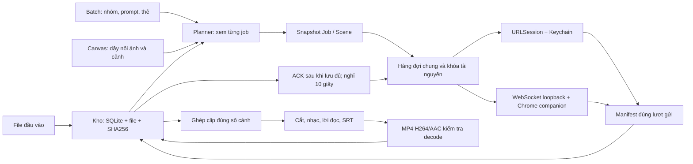

# Kiến trúc native

`Sources/MooZCore`: model Codable, planner, compiler Canvas, SQLite/store, hàng đợi, adapter API/Chrome, dispatch ledger và FFmpeg Process. Lõi không phụ thuộc SwiftUI, kiểm thử được trên Linux.

`Sources/MooZApp`: cửa sổ SwiftUI, Canvas AppKit, NSTextView kéo thẻ ảnh, AVPlayer, Keychain và listener Network.framework. Không có máy chủ Node.

`Tests/MooZCoreTests` kiểm dữ liệu, phục hồi và media thật. `NativeSmoke.swift` chạy fixture qua ViewModel trên macOS; không chứng minh tài khoản AI thật hoạt động.

## Dữ liệu

Job lưu project/group/copy, model/settings, binding thiết bị/phiên/tab/chat, role/alias và snapshot metadata đầu vào. Scene có requestID/requestCode riêng, prompt gốc/đã biên dịch, thứ tự input, receipt, manifest file và trạng thái. File gốc, clip trung gian, thành phẩm là Asset riêng; byte lưu content-addressed, metadata/provenance lưu SQLite. JSON job không chứa base64 media.

Trước POST/click, SQLite lưu dispatching và khóa tài nguyên. Lỗi chưa rõ đã gửi → unknown, chỉ đọc trạng thái cùng requestID. Partial giữ file tải được. ACK thất bại chỉ thử ACK. Khôi phục app không tự phát lại prompt.

API key nằm trong macOS Keychain. API adapter dùng URLSession trực tiếp; OpenContext, context-mode và Aider là công cụ phát triển bên ngoài, không phải runtime app và không tự gọi AI trả phí.

## Thư viện

SwiftUI, AppKit, AVKit, Foundation, Network, Security, ImageIO và SQLite là dependency hệ thống. FFmpeg/ffprobe native xử lý media. Bản Intel Ventura dùng nguồn khóa trong `Tools/media-sources.json`, dựng thư viện media tĩnh với deployment target 13. Script package vẫn kiểm toàn bộ dependency và minOS của binary, từ chối gói vượt target 13 trong CI.

ComponentsKit và MengTo/Spring dùng UIKit iOS, không tương thích app macOS này. Macaw có macOS nhưng đã deprecated; không đưa vào đường render chính. Dùng AppKit/SwiftUI thay thế.
